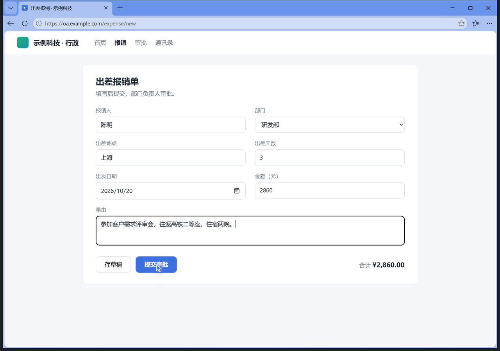
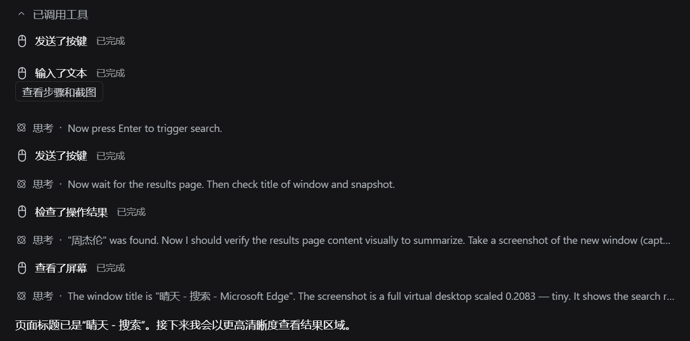
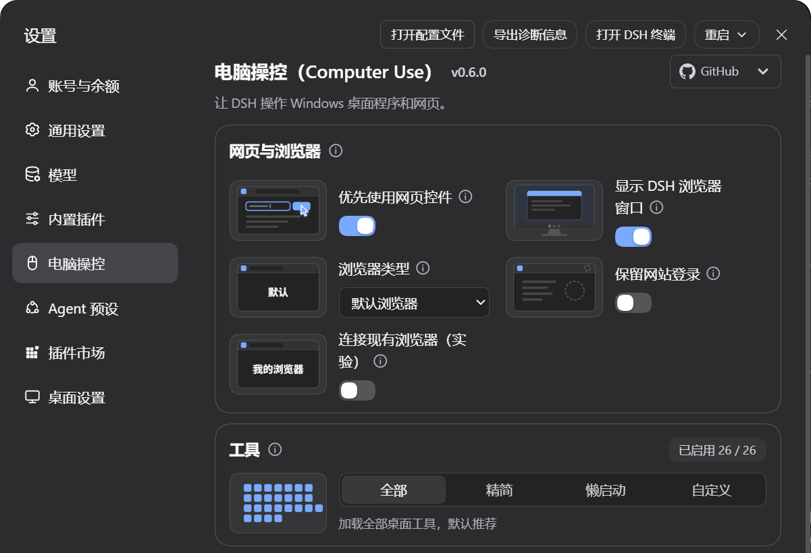
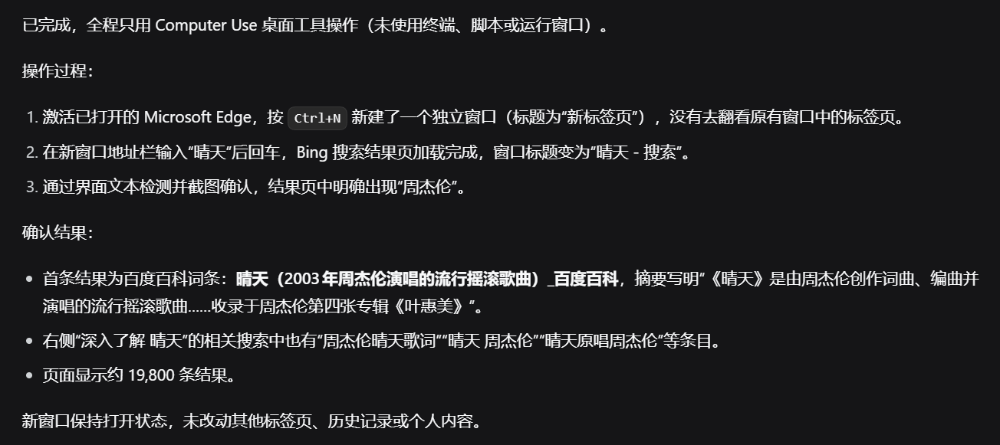
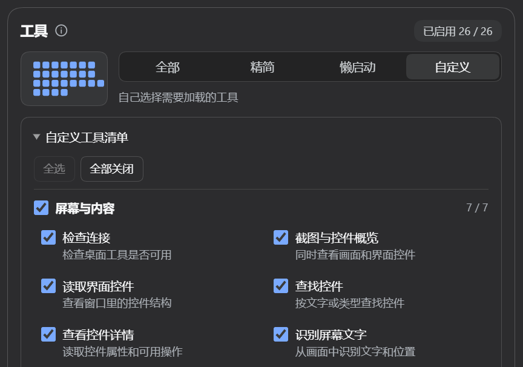
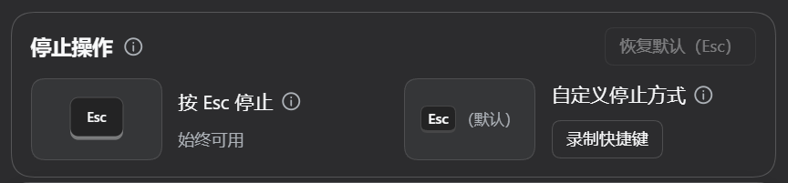
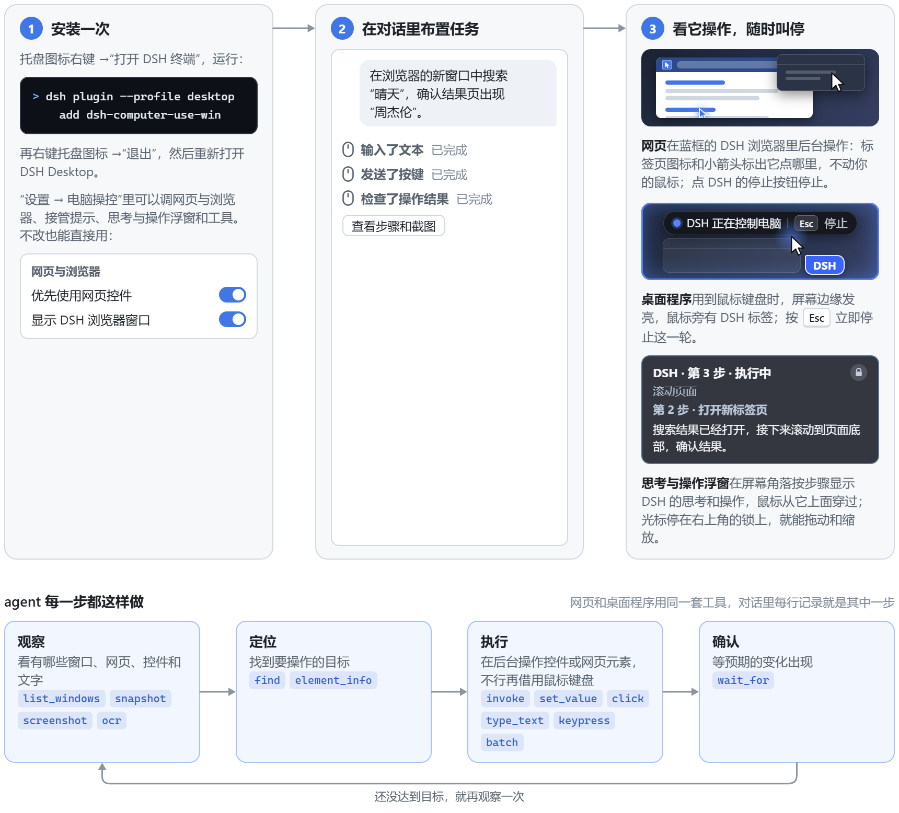
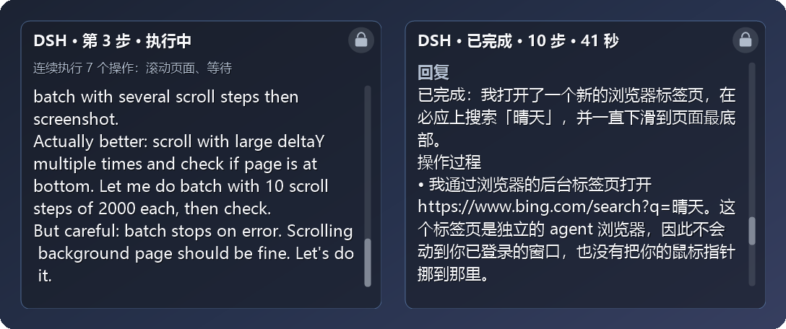
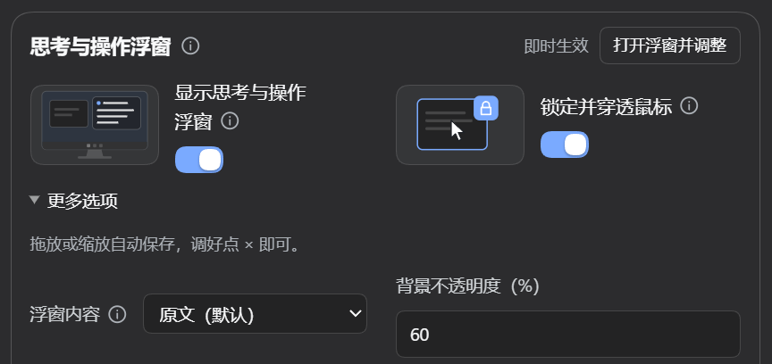
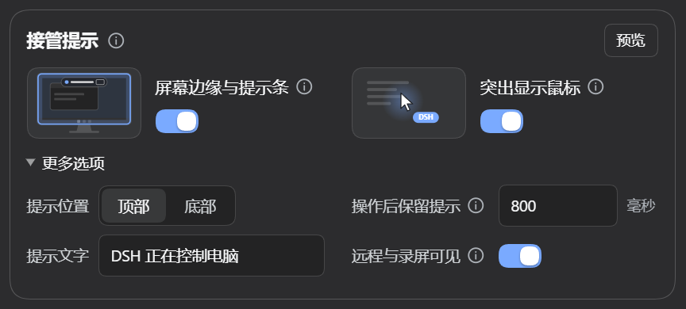

# dsh-computer-use-win

**Let DSH read and operate your Windows desktop.**

[](https://www.npmjs.com/package/dsh-computer-use-win) [](https://github.com/Yu-tao-Li/dsh-computer-use-win/actions/workflows/ci.yml)  [](LICENSE)

Your [**Star ⭐ ↗**](https://github.com/Yu-tao-Li/dsh-computer-use-win) keeps me motivated to update this project. Please, it means a lot to me! Found a problem or have a wish? [**Open an Issue ↗**](https://github.com/Yu-tao-Li/dsh-computer-use-win/issues/new) — **you make the wish, I’ll work on it!**

**语言 / Language:** [简体中文](#简体中文) · [English](#english)

[Releases](https://github.com/Yu-tao-Li/dsh-computer-use-win/releases) · [npm](https://www.npmjs.com/package/dsh-computer-use-win) · [Issues](https://github.com/Yu-tao-Li/dsh-computer-use-win/issues)

---

## English

This plugin lets [DeepSeek Harness](https://github.com/deepseek-ai/deepseek-harness) (DSH) see and use the real Windows apps and web pages on your computer. It can find buttons and text fields, read text on the screen, click, type, and switch or manage windows. Web pages are worked on in DSH's own browser in the background by default, without moving your pointer or taking the foreground.

**Web pages in the background · An overlay shows what DSH is thinking and doing, step by step · 25 action tools + 1 management entry · Clear indicators when the mouse or keyboard is used · Press Esc to stop at any time · Chinese and English settings**

<picture>
  <source media="(prefers-color-scheme: dark)" srcset="assets/diagrams/how-it-works-en-dark.png">
  
</picture>

**Contents:** [1 Quick start](#1-quick-start) · [2 Interface tour](#2-interface-tour) · [3 What it can do](#3-what-it-can-do) · [4 How it works](#4-how-it-works) · [5 Settings](#5-make-it-yours) · [6 Try a task](#6-try-a-task) · [7 Tools](#7-tools-and-options) · [8 FAQ](#8-faq) · [9 Privacy](#9-data-and-privacy) · [10 Development](#10-documentation-and-development) · [简体中文](#简体中文)

### 1. Quick start

#### 1.1 Install

You need a Windows computer with DSH Desktop installed. The plugin uses Windows PowerShell 5.1, which comes with Windows, so there is nothing else to install.

1. Right-click the DSH icon in the taskbar tray, choose **Open DSH Terminal**, and run:

   ```powershell
   dsh plugin --profile desktop add dsh-computer-use-win
   ```

2. Right-click the tray icon again, choose **Quit**, then open DSH Desktop again. Closing the window is not enough: DSH keeps running in the tray and does not load the new plugin.
3. Open **Settings → Computer Use** (the mouse icon; 电脑操控 in the Chinese interface) to look around. You don't have to change anything: all tools are loaded by default. Then give the agent a desktop task, such as one from [section 6](#6-try-a-task).

#### 1.2 Upgrade

DSH checks npm’s `latest` at startup. The update button is at the top right of **Settings → Computer Use**, to the left of the GitHub link when the project note is folded. Click **Check for updates** to check again right away. The button changes to **Update** when a newer version is available. Click **Update** to have the plugin market install it. The current step and progress appear below the title. **Stop update** keeps your installed version if you click it before the market starts replacing files. New releases usually reach the market after npm. If the market hasn’t picked up a new release yet, the page waits for it to sync before installing. If updating from settings fails, the page links to the market’s **Installed** tab so you can try there. In the market’s **Download region** setting, **Global** downloads directly from npm and **China mainland** uses a mirror.

**Starting with 0.6.3**, a confirmation appears when installation finishes. **Restart now** quits DSH Desktop normally and opens it again. Choose **Later** to keep working. **Restart to finish** stays beside the title and lets you reopen the confirmation any time.

**Upgrading from 0.6.1 or 0.6.2 to 0.6.3** uses the old settings page. Right-click the DSH icon in the taskbar tray, choose **Quit**, and open DSH Desktop again. Go straight to **Settings → Computer Use** and click **Update** before using computer use. If offered **Update anyway**, click it to continue. After installation, the settings page switches to the new version immediately, while DSH still runs the old version in the background. This upgrade has no restart confirmation. Choose **Quit** from the tray again, reopen DSH Desktop, and leave the Computer Use settings alone until it restarts. If the plugin is reported as removed, quit and reopen DSH Desktop, then reinstall it from the plugin market. Your previous settings are kept.

You can also run the install command above, then quit from the tray and reopen DSH Desktop. Without the plugin market or with a local-file install, **Update** opens these instructions. `desktop` in the command is the profile DSH Desktop uses. Installing into another profile leaves the DSH you’re using unchanged.

#### 1.3 Other ways to install

<details>
<summary>DSH Web, GitHub, standalone MCP clients</summary>

For DSH Web:

```powershell
dsh plugin --profile web add dsh-computer-use-win
```

Restart `dsh web` after installing. If you use another profile, replace `web` with its name. You can also search the plugin marketplace for **dsh-computer-use-win**, or install from GitHub:

```powershell
dsh plugin --profile desktop add github:Yu-tao-Li/dsh-computer-use-win
```

Outside DSH, any MCP client can launch it:

```json
{
  "mcpServers": {
    "wincu": {
      "command": "npx",
      "args": ["-y", "dsh-computer-use-win"]
    }
  }
}
```

DSH Web and standalone MCP clients run the plugin with the Node.js on your computer, which must be version 22 or later. DSH Desktop brings its own runtime, so it needs no separate Node.js.

Run on its own, the server loads all tools by default. Set `WCU_TOOL_MODE=lite` to load only the common tools, or `WCU_TOOL_MODE=lazy` to start with just the management entry. You can also list the allowed tools as a JSON array in `WCU_ENABLED_TOOLS`. The settings page, the action records in conversations and the turn-wide indicators exist only inside DSH. See [tool loading](docs/tool-context.md) for details.

</details>

### 2. Interface tour

These are real screenshots from DSH Desktop 2.0.18, with the Chinese interface. Each image shows only the browser window, the conversation or the settings panel; click one to see it at full size. The settings overview comes from 0.6.1 and the other settings screenshots from 0.6.0. The browser screenshot comes from 0.5.2 and the conversation screenshots from an earlier search task; neither part of the interface has changed since. The overlay images replay the record of a real task through the plugin's own overlay code.

#### 2.1 Web pages are worked on in the DSH browser

Web tasks go to Browser Use by default. DSH works in a browser window of its own: the window frame is DSH blue, the tab it works in shows a blue arrow as its icon, and a small glowing arrow on the page marks where it clicks. It reads pages, fills in forms and presses buttons through the browser's debugging protocol, without moving your pointer or bringing the window to the front, so you can keep using other apps. The screenshot shows the window while it filled in a sample expense form in the background (a demo page; the name is made up).



#### 2.2 Every step shows up in the conversation

Each desktop action is a row with a mouse icon, such as “Entered text”, “Sent a key press” or “Checked the result” (the screenshot shows the Chinese labels). Click **Steps and screenshots** to see the details and screenshots of each step.



#### 2.3 Reasoning and progress overlay

While DSH works on the computer, a translucent overlay in a corner of the screen shows what it is thinking and doing, step by step. Each step gets a heading with its action, followed by the reasoning for that step, the same text you see in the conversation. When the task ends, the heading shows that it is done, with the number of steps and the time taken, and the overlay shows the reply from its start for another 20 seconds. So you never have to bring the DSH window to the front to check on progress, which would interrupt the work. The overlay, the indicator bar and the AI summary use the DSH interface language: the language chosen in DSH, or the system's when none is chosen. Chinese, English and Russian are available for the overlay, indicator and AI summary. Other languages show English. The settings page still uses English for Russian.

![Two frames of the progress overlay, redrawn by the plugin's overlay code from the record of a real task (open a browser, search for 晴天 and scroll to the end). Left, during the task: the heading reads DSH · step 3 · acting, the subheading reads run 7 actions: scroll the page, wait, and below it is the model's reasoning for that step, in English. Right, after the task: the heading reads DSH · done · 10 steps · 41 s, followed by the start of the reply. Both overlays have the padlock button in the top-right corner](assets/desktop-progress-overlay-hd.png)

The overlay is locked by default, so the mouse passes through it and it never blocks a click by you or by DSH. To move or resize it, rest the pointer on the padlock in its top-right corner: the overlay unlocks for a moment, you can drag the title or the edges, and it locks again after the pointer leaves. Only your mouse unlocks it, including a mouse you use through a remote-control tool such as UU Remote; the pointer DSH moves never does. By default the overlay shows DSH's own output and costs no extra tokens. You can switch it to AI summary in the settings; the conversation's model then writes a sentence or two about the progress every so often, which uses extra tokens.

#### 2.4 Settings page

Open **Computer Use**, the mouse-icon tab on the left (电脑操控 in the Chinese interface). The plugin version is beside the title, with **Check for updates** or **Update** and **Report a problem** on the right. **Work mode** offers **Low disruption** (the default), **Foreground**, and **Virtual machine**. Low disruption works in the background where possible. Its **More details** section starts collapsed. Foreground uses the mouse and keyboard directly. Virtual machine mode works inside a configured Hyper-V VM.

The page also lets you choose which tools load and adjust browser options, the takeover indicator, the reasoning and progress overlay, and the stop shortcut. The small illustration beside each setting reflects your selection. Open the ⓘ icon for an explanation. Folding the Star and Issue note leaves a GitHub link and an expand arrow. Your choice survives upgrades.

*The screenshot below is from v0.6.1. Work mode and Check for updates had yet to be added. Update appeared only when a newer version was available.*



#### 2.5 More screenshots

<details>
<summary>Task summary, custom tools, overlay settings, control indicators, stop settings</summary>

*The Custom tools, overlay, control indicator and stop settings screenshots below are from v0.6.0.*

**Task summary.** When a turn ends, the agent explains what it did and what it confirmed on the results page. The text in this image was written by the model used for the task.



**Custom tools.** Choosing Custom opens the tool list with every tool checked; untick tools one by one or a whole group at once, then save. This is an unsaved demo that was discarded after the screenshot.



**Overlay settings.** The two switches, Show reasoning and progress overlay and Lock and pass through mouse, apply as soon as you change them. Under More options you choose the overlay content: Source (DSH's own reasoning and output) by default, or AI summary, which uses extra tokens. Further down are the background opacity, size, position and the lock shortcut. Open overlay to adjust shows a 60-second preview, so you can drag the overlay where you want it.


**Control indicators.** While the agent uses the mouse or keyboard on the desktop, a blue glow lines the screen edges, a “DSH is controlling your computer” bar appears at the top or bottom (in Chinese when DSH is set to Chinese), and a DSH tag follows the pointer. The screen and pointer indicators have their own switches, and Preview shows them on your screen. Placement, text, how long they stay and remote visibility are under More options.


**Stop settings.** Esc stops the agent by default. You can also record your own shortcut, such as F8.



</details>

### 3. What it can do

| What you want the agent to do | How the plugin does it |
|---|---|
| Find windows, buttons and text fields | It lists open windows, then uses UI Automation (UIA, the Windows interface that lets programs read on-screen controls) to find controls and their names |
| Read text on screen, including text in images and custom-drawn apps | It takes a screenshot and uses the built-in Windows text recognition (OCR) to find words and their positions; small text is enlarged before it is read, and the recognition language can be chosen. When an app exposes few controls and a search finds nothing, the search switches to OCR by itself |
| Click, type and fill in forms | It operates controls directly in the background when it can: pressing buttons, filling in fields, typing into text boxes and scrolling lists move neither your mouse nor the foreground and leave the clipboard alone. Steps that need the real mouse and keyboard (clicks at screen positions, pastes, key presses) only borrow the foreground, and give the mouse and the foreground back afterwards |
| Do several known steps at once | `batch` runs 1–20 planned actions in order and checks each one as usual. It stops on an error, a navigation, a dialog or a new window, and observes once at the end, which saves round trips |
| Look things up and fill in web pages without taking over your mouse | Pages in Chrome and Edge go through the browser lane: the plugin reads the page structure over the browser's debugging protocol and clicks or fills elements directly. Background tabs work too, without moving your mouse or bringing a window forward (see 7.4) |
| Work in the browser you already have open (experimental) | Once you turn it on in the settings and click Allow in the browser, the agent can work in pages already open in your own Chrome or Edge, such as a playing video (see 7.4) |
| Wait for changes and check that an action worked | It waits for a window, control or piece of text to appear, then reads or captures the screen to confirm |
| Show you what the agent is doing | The reasoning and progress overlay in a screen corner shows its reasoning and actions step by step; there are also screen indicators, the DSH tag next to the pointer, step records in the conversation and a summary at the end |

In a DSH conversation, each desktop action reads as a short sentence, such as “Clicked the target”, followed by its status: “Completed”, “Input sent; effect unconfirmed”, “Incomplete” or “Stopped”. The records are still there when you reopen the conversation.

### 4. How it works

#### 4.1 How a desktop task runs

The agent takes every step as **look → locate → act → confirm**. The lower half of the first figure shows this loop:

1. **Look**: list the open windows, read the controls, or take a screenshot and recognize the text.
2. **Locate**: find the button, text field or piece of text to work on.
3. **Act**: operate the control directly in the background when possible, such as pressing a button or filling in a field; otherwise use the mouse and keyboard, with the target window in front for that step only and the foreground and mouse given back afterwards.
4. **Confirm**: wait for the expected change and read the screen again. If the goal is not met yet, go back to step 1.

The plugin keeps two kinds of result apart. Input actions only report “sent” (`verification: "sent"`), because an app receiving input does not mean the task is done. Only `wait_for` reports “observed” (`verification: "observed"`), when the expected window, control or text actually appears. So when you give a task, say what should be checked.

#### 4.2 Architecture

<picture>
  <source media="(prefers-color-scheme: dark)" srcset="assets/diagrams/architecture-en-dark.png">
  
</picture>

The blue parts are this plugin's code, and the grey parts come from DSH, Windows or the browser. Here is what each part does:

- The **plugin adapter** (`mcp/dsh-plugin.mjs`) runs inside DSH. It passes your settings to the MCP server and tracks conversation turns, so only one conversation uses the desktop at a time. It also hands the conversation's reasoning and steps to the overlay.
- The **settings page and step records** (`mcp/client.js`) are the Settings → Computer Use page. The same file turns the tool calls in a conversation into readable steps.
- The **MCP server** (`mcp/server.mjs`) is started by DSH's official MCP bridge. It offers the tools of your preset, checks the arguments and passes each request to the backend.
- The **browser lane** (`mcp/browser.mjs`) also runs in the MCP server. When a call carries `browserTab` or a page element ID, it skips the PowerShell backend and goes straight to the browser over the Chrome DevTools Protocol.
- The **PowerShell backend** (`scripts/windows-uia.ps1`) reads the screen, sends input and takes screenshots. It stays running, so later calls skip PowerShell startup. Requests wait in a queue and run one at a time, so two actions never fight over the mouse and keyboard.
- The **takeover helper** (`scripts/windows-takeover.ps1`) is a separate process that draws the indicators and the reasoning and progress overlay, and listens for Esc itself. Because it goes through neither DSH nor the backend, it hears Esc even while the backend is busy: actions that have not started are cancelled, and input in progress stops as soon as it can.

See the [architecture notes](docs/wiki/architecture.md) for more detail.

### 5. Make it yours

Change these in **Settings → Computer Use**. Most take effect after you click Save changes; the two overlay switches apply at once. The page follows DSH's light or dark theme. If the settings cannot be read, the page says so instead of showing defaults that look valid.

#### 5.1 Settings

| Setting | Your choices |
|---|---|
| Update | The button left of the GitHub link at the top right: Check for updates, or Update when a newer version exists, which installs it only when clicked; see 1.2 |
| Report a problem | Saves a TXT to Downloads and opens GitHub’s new-issue page; see 8.4 |
| Tool loading | **All** (26 tools, the default); **Lite** (12 common tools); **Lazy** (starts with 1 management tool and loads the rest when needed, with all tools allowed); **Custom** (pick tools one by one or by group) |
| Work mode | **Low disruption** (the default): keep using your PC and the task keeps going. DSH does what it can in the background and opens the apps it starts on a hidden desktop; steps that need the mouse and keyboard run at once and borrow them briefly, while what you type or click meanwhile is held and then replayed to your window; it waits only while you hold a key, have input-method text not yet committed, or use a full-screen app; **Foreground**: for when you step away; DSH keeps its window in front and uses the mouse and keyboard directly, and Esc stops it; **Virtual machine**: works inside a Hyper-V virtual machine and never touches your PC, with one-time setup steps on the settings page. See [settings and stopping](docs/computer-use-settings.md) |
| Prefer web page controls | On by default. Pages it can read and operate directly are handled in the background, without moving the pointer or taking the foreground; desktop apps and page content it cannot read go to Computer Use |
| Show the DSH browser window | On by default, so you can watch the DSH browser; turn it off to run the browser in the background with no window |
| Browser type | Follows the Windows default browser, or choose Edge, Chrome or the Firefox family (experimental); when the default is neither Edge nor Chrome, an installed Chrome or Edge is used. The Firefox family starts with the Windows default one; see [Firefox-family browsers](docs/browser-bidi.md) |
| Keep website sign-ins | Off by default. When on, the DSH browser keeps one profile, and sites you sign in to in its window are still signed in next time; nothing to set up in your own browser and no prompts to allow. The settings page says how to sign in, where the sign-ins are kept and the risks; see 7.4 |
| Connect browser (experimental) | Off by default. When on, the agent can work in the Chrome or Edge you already have open. First allow remote debugging at `chrome://inspect/#remote-debugging` (or `edge://inspect/#remote-debugging`); after that the browser asks you every time it is connected. Only the browser chosen under Browser type is used, and Default means the Windows default browser; it is unavailable for the Firefox family. See 7.4 |
| Screen indicator | Turn the edge glow and the status bar on or off. Change the text, put the bar at the top or bottom, and choose how long it stays after a turn ends (0.2–3 seconds) |
| Pointer indicator | Turn the glow and DSH tag at the pointer on or off on their own. Your Windows pointer style is not changed, and the tag stays clear of enlarged pointers |
| Visible in remote sessions and recordings | On by default, so UU Remote, screen sharing and recordings can show the indicators and the reasoning and progress overlay too, including the model's reasoning and replies. It keeps up when you change monitors, layout or scaling |
| Reasoning and progress overlay | On by default; the switches apply at once. Lock and pass through mouse is on by default, and resting the pointer on the overlay's padlock unlocks it for moving and resizing; clicking × on the overlay closes only the current preview or turn window without disabling the feature. More options holds the overlay content (Source or AI summary), the background opacity, size, position and the lock shortcut. Open overlay to adjust shows a 60-second preview |
| Stop shortcut | Click Record shortcut, press the key you want (such as F8 or Ctrl + Alt + K), then save. Restore default (Esc) removes the extra shortcut |
| Preview | Click Preview next to the takeover indicator to apply indicator changes and see how they look on your screen (other unsaved draft changes remain untouched). Each setting's details sit behind an ⓘ icon; hover over it or click it to read them |

#### 5.2 Press Esc to stop at any time

Esc, or your own shortcut, stops this turn's desktop actions right away, including queued ones, and the agent will not retry them in the same turn. To carry on, send a new task or say “continue”. There is no need to visit settings. Normal mouse movement and other keys do not stop anything. Esc still works even if you turn the indicators off. Browser Use, reading the screen and background control actions do not take Esc, so Esc keeps working in your other apps. Until a turn first uses the mouse or keyboard, stop it with the stop button in DSH.

#### 5.3 When the indicators appear and disappear

They appear the first time a turn uses the mouse or keyboard and stay on through that turn's screenshots, reading and short pauses for thinking. Reading the screen, taking screenshots, waiting, and operating controls or web pages in the background show no indicator. When the turn ends, is cancelled or fails, they fade out after the delay you set. If 30 seconds pass after the last desktop action with nothing new, they also hide, and they come back with the next action. A standalone MCP server has no notion of turns, so it shows them for each call that uses the mouse or keyboard.

#### 5.4 Good to know

- The plugin operates controls in the background when it can, without moving the mouse or the foreground. Clicks at screen positions, pasting text and key presses still need the real mouse and keyboard: the plugin brings the target window forward, checks that no other window covers the click point, and afterwards puts the mouse back and returns the foreground to the window you had in front. If the action opened a menu, drop-down list or dialog, the window stays in front; if you switched windows or moved the mouse meanwhile, the plugin leaves them as you set them. Avoid using the mouse and keyboard during these steps.
- After the foreground goes back to you, later actions and screenshots that name no window still aim at the window the agent was working in, never at the one you are using. Text DSH pastes stays out of your clipboard history (Win+V). Native edit boxes such as Notepad and WordPad paste directly, and your clipboard comes back as soon as the paste is done. Other programs get your clipboard back only after they have read the text; if one never reads it, the text stays on the clipboard and the result says so, so a slow program never pastes your old content.
- Only one conversation can use the desktop at a time. Others get a “busy” result.
- DSH asks you first, and acts only after you agree, before it launches a program with arguments or through a shortcut, opens a local file in a page, uploads a local file to a page, connects to your own open browser, or acts for the first time on one of your own browser tabs. An approval covers that one call with those arguments; refusing or cancelling runs nothing. The agent cannot operate DSH's own windows, so it cannot click Allow for you. Under DSH's Full access preset, which shows no approval prompts, these calls run without asking, since that preset already lets the agent run any command unasked; Workspace Write, Read Only and the other presets ask first. The standalone MCP server has no such prompt and refuses these calls unless environment variables allow them; see [Safety](docs/wiki/safety.md).
- Inside DSH, a screenshot reaches the agent as the path of a PNG file and the image data stays out of the conversation, so several screenshots no longer fill the context. To send a screenshot over IM, have the IM tool send that file.
- An action already delivered to an app cannot be undone. If the app is stuck, stopping waits until it responds.
- Choosing Custom from another preset starts with every tool checked; uncheck the tools you do not want and save. A Custom selection you saved is shown as saved. Saved changes take effect after the current step finishes and survive a restart. The agent cannot turn on tools you have turned off.

See [settings and stopping](docs/computer-use-settings.md) for the full details.

### 6. Try a task

#### 6.1 Example tasks

> Type “Meeting notes” into Notepad, then read the text back to confirm it was entered.

> Calculate 25 × 4 in the open Calculator window and read the result.

> Open a browser, search for “Windows UI Automation”, confirm that results appeared, and summarize what you did.

> Open NetEase Cloud Music, search for “晴天”, and confirm that “周杰伦” appears in the results. If UIA cannot find the search box, use OCR to locate visible text.

When the task says what to confirm, the agent checks the result instead of stopping once the input is sent (see [4.1](#41-how-a-desktop-task-runs)). Results also depend on the app, the model and the page you are on.

### 7. Tools and options

#### 7.1 Tool list

There are **25 action tools and 1 management entry**. The table uses short names. The full name is `windows_computer_use_<name>`, and DSH usually adds a `mcp__wincu__` prefix.

| Purpose | Tools |
|---|---|
| Check the connection, find windows | `health` · `list_windows` |
| Read on-screen controls (UIA) | `snapshot` · `accessibility_tree` · `find` · `element_info` |
| Screenshots and text recognition | `screenshot` · `ocr` |
| Mouse | `click` · `double_click` · `move` · `drag` · `scroll` |
| Type and operate controls | `type_text` · `keypress` · `focus` · `invoke` · `set_value` |
| Launch apps, manage windows | `launch_app` · `activate_window` · `move_window` · `close_window` |
| Wait and confirm | `wait_for` · `wait` |
| Run planned actions in a batch | `batch` |
| Manage tools | `tools` |

`launch_app` starts programs through the Windows desktop (Explorer), so they keep running after the tool call ends. Command interpreters and script hosts such as cmd and PowerShell start only without arguments; run commands with DSH's own shell tool.

`batch` runs 1–20 planned actions, such as clicks, typing, selection, key presses and scrolling, on one window or one browser tab. Each step goes through the usual checks: the tool switches in the settings, the Esc stop and the check that the click point is not covered. The batch stops on an error or on input that could not be confirmed. A navigation, a dialog, a new window or a closed target stops it before the next step; when the last step causes one, the batch completes and `afterLastStep` names the change, as when a submit opens the next page. It returns the result of every step and observes once at the end.

#### 7.2 Lite preset and the management entry

Lite includes `list_windows`, `find`, `click`, `scroll`, `type_text`, `keypress`, `ocr`, `screenshot`, `wait_for`, `launch_app`, `batch` and `tools`.

Through the `tools` entry, the agent can read a tool's description, and unload or reload tools you have allowed. `reset` returns to your saved startup set. Unloading a tool does not remove its description or results from the conversation.

#### 7.3 Tips

When UIA can find a control, operate it directly with `invoke` or `set_value`; both run in the background. With `action`, `invoke` can also expand or collapse a control or scroll it into view, and `scroll` on an element ID scrolls in the background first. Send an Excel Ribbon sequence such as Alt, H, O, W (Column Width) as one `keypress` with `thenKeys`, so the foreground is not handed back between the keys. When UIA finds nothing, or very little, read the screen text with OCR, and let a model that can see images read the screenshot for icons and layout. OCR returns only text and screen positions; it never makes up control IDs. Look again after a window moves or a control changes.

To press Enter in a field after `set_value` (a search box, an address bar), note that a `keypress` without a window target goes to the window DSH last worked in this turn. Whether `set_value` moves the focus into the field depends on the app: Chromium does, a Win32 edit does not, so `focus` the field first to be sure. Key and typing results include `deliveredTo`, the window and control that actually got the input. When no window target was given and DSH has not worked in any window this turn, the input reaches the window in front and the result says `unconfirmed`. `list_windows` lists minimized windows too (`minimized: true`) and says `truncated` when there are more windows than `maxWindows`. `activate_window` restores a minimized window first; the result says `restored: true`, and `window` shows the window after the call. A screenshot of a minimized window gets only its title strip, so the result says `minimized: true` and to restore it first. `ocr` with a `query` returns only the matching lines, without the whole text and every word box.

Electron apps, Chrome and Edge are all built on Chromium. Such an app builds the controls of a page only once another program reads the page. So the first time the plugin reads one of these windows, it turns the page's control tree on, and the page's buttons and input boxes usually become readable within half a second. `webContent` in the result tells you whether the page is ready. If it says `starting`, wait a moment and read again.

[Parameters and results](docs/wiki/mcp-tools.md) · [On-demand loading and client compatibility](docs/tool-context.md) · [How apps differ](docs/wiki/app-technology-matrix.md)

#### 7.4 Browser lane

For web pages, the plugin does not have to read screenshots or move the mouse. It reads the page structure over the Chrome DevTools Protocol (CDP), then clicks, fills and selects elements directly. All of this happens inside the browser: your mouse does not move, the clipboard is not used and no window comes to the front, so tabs in the background work too. Browser Use adds no tools; what is new is a `browserTab` argument and page element IDs:

1. The result of `list_windows` includes `browserLane`, which lists the tabs of connected browsers. Each tab has an ID such as `t1a2b`.
2. Pass that ID as `browserTab` to `snapshot`, `accessibility_tree`, `find`, `type_text`, `keypress`, `scroll`, `screenshot` or `wait_for` to read or operate that page. Every element on the page comes with an ID such as `t1a2b:57`, which works directly in `click`, `set_value`, `focus`, `invoke`, `scroll` and `element_info`. After each action, the result shows what changed on the page. An element ID is valid only for the page it was read from: read the page again after it navigates. After the plugin's server restarts, tab IDs change too, so call `list_windows` first.
3. `set_value` with a web address on `t1a2b:address` opens it in that tab; on `new-tab`, it opens the address in a new background tab.

The browser comes from one of three places:

- **The agent browser (default).** The first `new-tab` opens a visible browser window without bringing it to the front. Which browser is a setting: by default the Windows default browser, and an installed Chrome or Edge when that is neither; the Firefox family is an experimental choice that runs in the background (see [Firefox-family browsers](docs/browser-bidi.md)). It starts from a fresh temporary profile every time, and its tabs run in a separate isolated context, so they never see your cookies, sign-ins or history. It exits with the plugin process and closes after 10 idle minutes headless or two hours visible; page activity also extends its lifetime. Edge signs a new profile in to your Windows Microsoft account on its own; the agent's tabs stay in the isolated context and cannot use that sign-in, the window shows no account, and the temporary profile is deleted after the browser closes. Turn off Show the DSH browser window in settings to run it in the background with no window. Browser Use shows no screen edges or pointer tag.
- **Keep website sign-ins.** For tasks that need you signed in, turn on Keep website sign-ins in the settings; it is off by default. The DSH browser then stops starting from a temporary profile and keeps one profile per browser (`kept-edge`, `kept-chrome` under `%LOCALAPPDATA%\dsh-computer-use-win\agent-browser`): sites you sign in to in its window (the blue frame) are still signed in for later tasks, also sites where you did not tick “remember me”. The first time a task needs a site that asks you to sign in, the agent asks you to sign in once in that window; you type passwords and codes yourself. Your own browser is never touched: no remote debugging to turn on and no prompts to allow. With Edge, Edge signs this profile in with the Microsoft account of your Windows, so Microsoft’s own sites are signed in already; choose Chrome to avoid that. Sign-ins stay when you turn the switch off; to remove them all, exit DSH and delete that folder. Risks: DSH acts as you on the sites you signed in to there; page text can try to steer the agent; in 0.6.0, CDP uses a named pipe with no local debugging port, though sign-ins stay in that profile folder and remain readable by other programs under your Windows account.
- **Connect browser (experimental).** Off by default. When on, `list_windows` only reads the `DevToolsActivePort` file the browser writes, lists your browser as available and offers a `"<browser id>:connect"` handle; it neither connects nor shows a prompt. The agent first asks you to get ready to click Allow in the browser, then writes `connect` to that handle with `set_value`, and only then does the browser ask you. A refusal or timeout stops there with no automatic retry, and the listing says not allowed or timed out, so prompts never pile up. Once connected, tool results show the addresses of your own tabs without the part after `?` or `#`. The agent works only in tabs you mention or tabs it opened, and asks before sending, buying, deleting or changing account settings. Disconnecting leaves your browser running. While connected, the browser shows a bar saying it is controlled by automated test software.

The Chromium lane reads and operates same-origin, cross-origin and nested iframes. Element ids bind their frame and document and expire on navigation/removal. With browserTab, coordinates use CSS pixels in the current page screenshot viewport, including canvas; the desktop pointer does not move. With the browser window shown, Chrome's own JavaScript dialogs (alert, confirm and the like) sometimes come to the front briefly. Shortcuts such as Ctrl+L and Ctrl+T belong to the browser window and never reach the page; use `address`, `new-tab` and `close_window` instead. Environment variables and result formats are in the [MCP tools reference](docs/wiki/mcp-tools.md#browser-lane).

#### 7.5 Read less to save context

- **Summarize a tree.** Use `detailLevel:"summary"` with `accessibility_tree` or `snapshot` on Windows controls. Each node keeps its ID, control type, name and states.
- **Set a tree byte budget.** `maxBytes` starts at 2,000 and limits the UTF-8 JSON response. Screenshots are separate. Over the limit, the tool summarizes the tree first, then keeps actionable controls and their ancestors, then cuts the tree by level. If it cuts the tree, `budget.fullResultPath` points to the complete result. If the remaining content still cannot fit, the response gives the file path.
- **Read just the changes.** Pass `treeDeltaBase:"start"` to `accessibility_tree` to get a tree and `treeId`. Pass that ID as `treeDeltaBase` when reading the same target again to get added, removed and changed controls and a new `treeId`. Use `detailLevel:"full"` to compare control values. A missing baseline, a different window or view settings, a truncated tree, or more than 40% of nodes changing falls back to a tree with the reason in `delta.fallback`. A delta over `maxBytes` also falls back to a tree reduced to fit the budget. A tree reduced by the budget cannot serve as a delta baseline.
- **Set an OCR byte budget.** `ocr` also accepts `maxBytes` starting at 2,000. Over the limit, it drops word boxes first, then the combined text that repeats the lines, and finally lines from the end. If it cuts lines or returns only a file reference, `budget.fullResultPath` points to the complete result.

Windows UI Automation trees and snapshots report `countedDepth` (the deepest level counted against `maxDepth`) and `structuralDepth` (the deepest actual level below the root) for the tree read by the backend before summarizing, trimming or computing a delta.

To check whether one control changed, use `find` to locate it or `wait_for` to wait for the target state. See the [MCP tool reference](docs/wiki/mcp-tools.md#accessibility_tree) for arguments and results.

### 8. FAQ

#### 8.1 It's installed, but I see no tools or settings, or an old version is still running

Most often, DSH Desktop was not fully restarted. Closing the window leaves DSH running in the tray with the old plugin, so right-click the tray icon, choose Quit, and open DSH Desktop again.

Also check that the plugin went into the profile DSH is actually using. The version appears in the MCP `initialize.serverInfo.version`; with All selected, the agent can also call `health` to check the connection. Each profile should have only one `serverName: wincu` service. If an older version left a duplicate manual entry, back it up first, then follow the [upgrade notes](docs/computer-use-settings.md).

When you save settings, DSH writes a row with `id: mcp-dsh-computer-use-win` into the profile's `cordis.patch.yml`. That row holds your settings, so keep it. With Lite or Lazy selected, tools outside the preset, such as `health`, are not listed, and calling one directly returns unknown tool. Ask the agent to call the management entry `windows_computer_use_tools` with `{"operation":"list"}` to see which tools are loaded and which can be loaded. If a saved setting holds a value this version does not offer, for example after switching versions, the plugin uses the default for that setting, loads as usual, and names the reset value under `notices` in the tools list and in `health`.

When you report an issue, include the DSH Desktop, dsh core and plugin versions, plus the error text with private details removed.

#### 8.2 Why did a click or typed text have no effect?

Check that the target window is not covered and still responds. A click at a screen position whose point shows another window, such as a notification, is not sent, and the result names the covering window (`POINT_COVERED`). The `foreground` and `pointer` fields of a result say whether the step borrowed the foreground and whether it gave it back. Chromium, Electron and some WinUI apps ignore input sent to background windows, so prefer UIA, or bring the window to the front before typing, and then look at the result. A target with a higher Windows integrity level than the input worker is refused with `ELEVATED_TARGET_DENIED`. If Windows prevents verification of the target, the plugin reports `INPUT_TARGET_ACCESS_UNCONFIRMED`. Leave UAC prompts to the user. The plugin also needs a normal, unlocked desktop session.

#### 8.3 What about PowerShell 7, other systems or a built-in vision model?

It works on Windows only. DSH can also run inside WSL (for example `dsh web` in a WSL shell): the plugin then starts Windows PowerShell through WSL interop and still operates the Windows desktop, as long as WSL can start Windows programs (`powershell.exe` runs). PowerShell 5.1 is the default, and its text recognition (WinRT OCR) has been tested on real screens. The automated tests cover both PowerShell 5.1 and 7. Under 7, reading controls and taking screenshots are tested for real, but text recognition is only tested at the protocol level, so OCR under PowerShell 7 is not guaranteed.

The plugin provides desktop tools only. It does not include a model, an API key, or image parsers such as OmniParser or UI-TARS. A model that can see images, or a separate parsing service, can read the screenshots and pass positions back to the tools.

#### 8.4 How do I report a problem?

Click Report a problem at the top right of **Settings → Computer Use**. DSH saves `wincu-diagnostics-date-time.txt` to Downloads, selects it in File Explorer, and opens GitHub’s new-issue page in your default browser. A dialog shows the file name and where it was saved. If Downloads cannot be written, a Save As dialog lets you choose another folder.

Describe what happened, what you expected, and how to reproduce it. Review the TXT, then drag it into the issue description and submit.

The TXT contains the plugin version and install source, DSH and runtime details, Windows, PowerShell, screen and browser information, relevant settings, self-test results, the last 30 computer-use calls, and up to 200 plugin log lines. Tool input text is kept as its length. You can attach a screenshot separately after covering private details.

### 9. Data and privacy

Reading controls, text recognition, screenshots and input all run on your computer. The results go to DSH or another caller, and whether they are then sent to a remote model depends on your DSH and model settings. Screenshots and recognized text can include sensitive content from your windows, so hide accounts, paths, passwords and private chats before you share logs or open an issue.

Pages read through the browser lane are also processed on your computer before they go to the caller. By default the agent browser carries no sign-ins; with Keep website sign-ins on, the agent can read and operate the sites you signed in to in the DSH browser. With Connect browser on and a connection allowed, the agent can read and operate every site signed in to in that browser, so turn it on only when needed, and you can turn remote debugging off in the browser afterwards. Page text can also carry instructions aimed at the agent, so every page outline starts by reminding the model that page content is untrusted and only your instructions count.

The settings page reads this plugin’s `latest` from npm (registry.npmjs.org) and checks the installed package through the local DSH plugin market. The npm request uses the package name.

The diagnostics file from Report a problem stays on your computer until you drag it onto an issue page; 8.4 lists what it holds.

### 10. Documentation and development

#### 10.1 Documentation

[Settings and stopping](docs/computer-use-settings.md) · [Tool loading](docs/tool-context.md) · [Tool reference](docs/wiki/mcp-tools.md) · [Architecture](docs/wiki/architecture.md) · [Test notes](docs/dev-notes.md) · [Changelog](CHANGELOG.md)

#### 10.2 Development and testing

See [4.2 Architecture](#42-architecture) for how the parts fit together.

```powershell
npm ci
npm test
```

The standalone MCP server needs no third-party packages at runtime. Inside DSH, it uses DSH's own Schemastery and the official MCP bridge. Development dependencies are only for testing. `npm test` runs **88 isolated regression suites** covering settings compatibility, takeover and stopping, the progress overlay, reading controls, capture, OCR protocols, input edge cases, batch actions and the browser lane. It sends no real keyboard or mouse input and does not touch your installed DSH profiles. Tests that need a real interface use only their own test windows and temporary browser profiles, and logs go to the temporary folder the command prints.

`node test/notepad-e2e.mjs` is a separate test that really types. It opens Notepad, so run it on a dedicated test desktop.

The two figures in this README are generated from the pages in `assets/diagrams/`. After changing their text, run `node assets/diagrams/render.mjs`; it uses your local Chrome or Edge to export all 8 images again, in Chinese and English, light and dark.

MIT licensed. Derived from [cgissing/windows-computer-use](https://github.com/cgissing/windows-computer-use); see [THIRD_PARTY.md](THIRD_PARTY.md) for attribution and copyright.

[Plugin marketplace](https://awesome-dsh-plugin.com) · [Releases](https://github.com/Yu-tao-Li/dsh-computer-use-win/releases) · [Report an issue](https://github.com/Yu-tao-Li/dsh-computer-use-win/issues) · [Back to English ↑](#english)

---

## 简体中文

这个插件让 [DeepSeek Harness](https://github.com/deepseek-ai/deepseek-harness)（DSH）看到并操作你电脑上真实的 Windows 程序和网页：找到按钮和输入框，读出屏幕上的文字，点击、打字，切换和管理窗口。网页默认在 DSH 自己的浏览器里后台完成，不动你的鼠标，也不抢前台。

**网页在后台完成 · 浮窗按步骤显示 DSH 在想什么、做什么 · 25 个操作工具 + 1 个管理入口 · 用到鼠标键盘时有明显提示 · 按 Esc 随时停止 · 中英文设置界面**

<picture>
  <source media="(prefers-color-scheme: dark)" srcset="assets/diagrams/how-it-works-zh-dark.png">
  
</picture>

**目录**：[1 快速开始](#1-快速开始) · [2 界面预览](#2-界面预览) · [3 能做什么](#3-能做什么) · [4 工作原理](#4-工作原理) · [5 设置](#5-按你的习惯设置) · [6 使用示例](#6-使用示例) · [7 工具与进阶](#7-工具与进阶) · [8 常见问题](#8-常见问题) · [9 数据与隐私](#9-数据与隐私) · [10 文档与开发](#10-文档与开发) · [English](#english)

### 1. 快速开始

#### 1.1 安装

你需要一台 Windows 电脑，并且已经装好 DSH Desktop。插件用的是 Windows 自带的 PowerShell 5.1，不用另外安装。

1. 右键点击任务栏托盘里的 DSH 图标，选“打开 DSH 终端”，然后运行：

   ```powershell
   dsh plugin --profile desktop add dsh-computer-use-win
   ```

2. 再右键托盘图标，选“退出”，然后重新打开 DSH Desktop。只关掉窗口不够：窗口关了，DSH 还在托盘里运行，不会加载新装的插件。
3. 打开 **设置 → 电脑操控**（鼠标图标）看看各项选项。不改也能直接用，默认加载全部工具。然后给 agent 布置一个桌面任务，比如[第 6 节](#6-使用示例)里的例子。

#### 1.2 升级

DSH 启动时按 npm 的 `latest` 自动检查。**设置 → 电脑操控** 的更新入口在标题右侧。项目说明折叠时，入口位于 GitHub 链接左边。点 **检查更新** 会立即再查，发现新版后按钮会变成 **更新**。点 **更新** 后，插件市场下载安装，标题下方显示当前步骤和进度。市场开始替换插件文件前，可以点 **停止更新** 保留现有版本。市场收录新版通常比 npm 晚一些。新版刚发布、市场还没同步时，页面会自动等待同步后再安装。按钮更新失败时，可以从页面直达插件市场的 **已安装** 再试。下载跟随插件市场的 **下载区域** 设置。选 **全球** 直接从 npm 下载，选 **中国大陆** 则走镜像。

**从 0.6.3 起**，安装完成后会弹出确认。点 **立即重启**，DSH Desktop 会正常退出并自动重新打开。点 **稍后**，标题旁会保留 **重启以完成更新**，可以随时重新打开确认。

**从 0.6.1 或 0.6.2 升到 0.6.3** 时，由旧版页面执行更新。先右键任务栏托盘里的 DSH 图标，选 **退出**，再打开 DSH Desktop。先别用电脑操控，直接在 **设置 → 电脑操控** 点 **更新**。如果看到 **仍要更新**，点它继续。装好后设置页会立即换成新版，后台仍运行旧版。这一次没有重启确认。请再次从托盘 **退出** 并打开 DSH Desktop，重启前先别改电脑操控设置。如果提示插件被移除，退出并打开 DSH Desktop 后可从插件市场重新安装，原来的设置会保留。

也可以运行上面的安装命令，再从托盘退出并重新打开 DSH Desktop。没有插件市场或从本地文件安装时，**更新** 会打开这段说明。命令里的 `desktop` 指 DSH Desktop 使用的配置（profile）。安装到其他 profile 时，正在用的 DSH 不会有任何变化。

#### 1.3 其他安装方式

<details>
<summary>DSH Web、GitHub 源、单独的 MCP 客户端</summary>

DSH Web：

```powershell
dsh plugin --profile web add dsh-computer-use-win
```

装好后重启 `dsh web`。用别的 profile 时，把 `web` 换成它的名字。也可以在插件市场搜索 **dsh-computer-use-win**，或者从 GitHub 安装：

```powershell
dsh plugin --profile desktop add github:Yu-tao-Li/dsh-computer-use-win
```

不在 DSH 里，也可以让任何 MCP 客户端启动它：

```json
{
  "mcpServers": {
    "wincu": {
      "command": "npx",
      "args": ["-y", "dsh-computer-use-win"]
    }
  }
}
```

DSH Web 和单独的 MCP 客户端会用你电脑上的 Node.js 运行插件，需要 22 或更高版本。DSH Desktop 自带运行环境，不用另装 Node.js。

单独运行时默认加载全部工具。设置环境变量 `WCU_TOOL_MODE=lite` 只加载常用工具，`WCU_TOOL_MODE=lazy` 开始时只加载管理入口。也可以在 `WCU_ENABLED_TOOLS` 里写一个 JSON 数组，指定允许哪些工具。设置页、对话里的操作记录和整轮提示只有在 DSH 里才有。详见[工具加载说明](docs/tool-context.md)。

</details>

### 2. 界面预览

下面是 DSH Desktop 2.0.18 里的真实截图（中文界面），只保留了浏览器窗口、对话或设置面板，点击图片可以看原图。设置页总览截图来自 0.6.1，其他设置截图来自 0.6.0；浏览器截图来自 0.5.2，对话截图来自更早的一次搜索任务，这两处的界面到 0.6.1 都没有变。浮窗图用的是一次真实任务的记录，由插件自己的浮窗程序重新画出来。

#### 2.1 网页在 DSH 浏览器里操作

网页任务默认交给浏览器操控（Browser Use）。DSH 用自己的浏览器窗口工作：窗口框是 DSH 蓝，正在操作的标签页图标换成蓝色箭头，网页上一个带光晕的小箭头标出它点的位置。它通过浏览器的调试协议读网页、填表、点按钮，不移动你的鼠标，也不把窗口切到前台，你可以接着用别的程序。下图是它在后台填写一张示例报销单时的窗口（示例网页，人名是虚构的）。


#### 2.2 对话里能看到每一步

每次桌面操作都是一行带鼠标图标的记录，比如“输入了文本”“发送了按键”“检查了操作结果”。点“查看步骤和截图”，可以看到每一步的详情和截图。


#### 2.3 思考与操作浮窗

DSH 操作电脑时，屏幕角落有一个半透明的浮窗，按步骤显示它在想什么、做了什么。每一步一个小标题，写明这一步的操作，后面是这一步的思考文字，和对话里看到的一致。任务结束后，标题变成“已完成 · 步数 · 用时”，浮窗从回复开头显示结果，再保留 20 秒。这样你不用把 DSH 窗口拉到前面查看进度，也就不会打断它的操作。浮窗、提示条和 AI 总结的文字跟着 DSH 的界面语言走：DSH 里选了哪种语言就用哪种，没选时跟系统；目前提供中文、英文和俄文，其他语言暂时显示英文。设置页在俄文环境下仍显示英文。



浮窗默认锁定，鼠标从它上面穿过，不会挡住你或 DSH 的点击。想换位置或大小时，把光标移到右上角的锁上停一下，浮窗就会临时解锁：拖标题移动，拖边缘缩放，光标离开后自动锁回。这个按钮只认你的鼠标，通过 UU 远程等远程控制软件操作的鼠标也算；DSH 操作时移动的光标不会触发它。浮窗默认直接显示 DSH 的输出，不额外消耗 token；也可以在设置里改成“AI 总结”，让当前对话的模型每隔一段时间写一两句进度说明，这会额外消耗 token。

#### 2.4 设置页

在左侧打开带鼠标图标的 **电脑操控**。标题旁显示插件版本，右侧有 **检查更新** 或 **更新**，以及 **反馈问题**。**工作方式** 可以选 **少打扰**（默认）、**前台操作** 或 **虚拟机**。少打扰会尽量在后台操作，详细说明默认折叠在 **更多说明** 里。前台操作直接使用鼠标和键盘。虚拟机模式在配置好的 Hyper-V 虚拟机里操作。

页面上还能调整工具加载方案、网页与浏览器、接管提示、思考与操作浮窗和停止快捷键。每项左边的小图会随设置变化，说明收在 ⓘ 图标里。顶部的 Star 和 Issue 说明可以折叠，折叠后只留 GitHub 链接和展开箭头，升级后也会保持这个选择。

*下图取自 v0.6.1。当时还没有“工作方式”和“检查更新”，只有发现新版时才会显示“更新”。*


#### 2.5 更多截图

<details>
<summary>任务总结、自定义工具、浮窗设置、接管提示、停止设置</summary>

*下面的自定义工具、浮窗、接管提示和停止设置截图取自 v0.6.0。*

**任务总结。** 一轮操作结束后，agent 会说明自己做了什么、在结果页里确认了什么。图中的文字由这次任务用的模型生成。


**自定义工具。** 选“自定义”后会展开工具清单，默认全部勾选，可以一个个取消，也可以整组取消，再点“保存更改”。图中是没有保存的演示，截完图就放弃了。


**浮窗设置。** “显示思考与操作浮窗”和“锁定并穿透鼠标”两个开关改了就生效。展开更多选项，可以选浮窗内容：默认“原文”，直接显示 DSH 的思考和输出；选“AI 总结”会额外消耗 token。再往下能调背景不透明度、大小、位置和锁定快捷键。点“打开浮窗并调整”会显示 60 秒的预览，方便把浮窗拖到合适的位置。



**接管提示。** agent 用鼠标键盘操作桌面时，屏幕边缘会亮起蓝色光晕，顶部或底部出现“DSH 正在控制电脑”提示条（英文界面显示英文），鼠标旁跟着一个 DSH 标签。屏幕提示和鼠标提示可以分别开关，点“预览”能在你的屏幕上试看；提示位置、文字、保留时长和远程录屏可见收在“更多选项”里。



**停止设置。** 默认按 Esc 停止。你也可以再录一个自己的快捷键，比如 F8。


</details>

### 3. 能做什么

| 你想让 agent 做的事 | 插件怎么做到 |
|---|---|
| 找到窗口、按钮和输入框 | 列出打开的窗口，再通过 UI Automation（UIA，Windows 给程序读取界面控件的接口）找到控件和它们的名字 |
| 读出界面上的文字，包括图片和自绘界面里的字 | 截图，用 Windows 自带的文字识别（OCR）找出文字和位置；小字会先放大再识别，也可以指定识别语言。界面控件很少、又没找到目标时，查找会自动改用 OCR |
| 点击、输入、填写表单 | 优先在后台直接操作控件：按下按钮、填入内容、往输入框里打字、滚动列表，都不动鼠标、不抢前台、不用剪贴板。必须用鼠标键盘的步骤（按坐标点击、粘贴、按键）只临时借用前台，做完把鼠标和前台还给你 |
| 一次做完几个确定的操作 | `batch` 按顺序执行 1–20 个已经规划好的动作，每一步照常检查。出错、页面跳转、弹出对话框或出现新窗口时就停下，最后只观察一次，省下来回的轮数 |
| 在浏览器里查资料、填网页，不占用你的鼠标 | Chrome 和 Edge 里的网页走浏览器通道：插件通过浏览器的调试协议直接读网页结构，按元素点击和填写。标签页在后台也能操作，不移动鼠标，也不把窗口切到前台（见 7.4） |
| 操作你已经打开的浏览器（实验性） | 在设置里打开后，你在浏览器里点“允许”，agent 就能操作你自己的 Chrome 或 Edge 里已经开着的页面，比如正在播放的视频（见 7.4） |
| 等页面变化，确认操作真的生效 | 等某个窗口、控件或文字出现，再读取或截图确认 |
| 让你看清 agent 在做什么 | 屏幕角落的思考与操作浮窗按步骤显示它的思考和操作；另外还有屏幕提示、鼠标旁的 DSH 标签、对话里的步骤记录和结束总结 |

在 DSH 对话里，每次桌面操作都写成一句好懂的话，比如“点击了目标位置”，后面标出状态：“已完成”“操作已发送，效果待确认”“未完成”或“已停止”。重新打开对话时，这些记录还在。

### 4. 工作原理

#### 4.1 一次桌面任务怎么进行

agent 每一步都按“观察 → 定位 → 执行 → 确认”来做，开头那张图的下半部分画的就是这个循环：

1. **观察**：列出打开的窗口，读取界面控件，或者截图并识别文字。
2. **定位**：找到要操作的按钮、输入框或文字的位置。
3. **执行**：能直接操作控件就在后台直接操作，比如按下按钮、填入内容；不行再用鼠标和键盘，这时目标窗口只在这一步来到前面，做完把前台和鼠标还给你。
4. **确认**：等预期的变化出现，再读一次界面。没达到目标，就回到第 1 步。

插件会区分两种结果。输入类操作只返回“已发送”（`verification: "sent"`），因为程序收到了输入，不等于任务完成了。只有 `wait_for` 看到预期的窗口、控件或文字出现时，才返回“已确认”（`verification: "observed"`）。所以布置任务时，最好写明要确认什么。

#### 4.2 整体架构

<picture>
  <source media="(prefers-color-scheme: dark)" srcset="assets/diagrams/architecture-zh-dark.png">
  
</picture>

图里蓝色的部分是本插件的代码，灰色的部分由 DSH、Windows 或浏览器提供。各部分的分工如下：

- **插件适配器**（`mcp/dsh-plugin.mjs`）运行在 DSH 里。它把你的设置交给 MCP 服务，并跟踪对话的轮次，保证同一时间只有一段对话在操作桌面，还把这段对话的思考和步骤交给思考与操作浮窗。
- **设置页与操作记录**（`mcp/client.js`）就是“设置 → 电脑操控”这一页。它也负责把对话里的工具调用显示成好懂的步骤。
- **MCP 服务**（`mcp/server.mjs`）由 DSH 的官方 MCP 桥启动。它按你选的方案提供工具，检查参数后把请求交给后端。
- **浏览器通道**（`mcp/browser.mjs`）也运行在 MCP 服务里。调用带上 `browserTab` 或网页元素 ID 时，请求不经过 PowerShell 后端，而是通过 Chrome DevTools 协议直接交给浏览器。
- **PowerShell 后端**（`scripts/windows-uia.ps1`）负责读取界面、发送输入和截图。它一直运行，所以后续调用不用每次重新启动 PowerShell。请求排队，一次只执行一个，两个操作不会同时抢鼠标和键盘。
- **接管助手**（`scripts/windows-takeover.ps1`）是单独的进程，负责屏幕提示和思考与操作浮窗，并直接监听 Esc。因为它不经过 DSH 和后端，后端正忙时也能收到 Esc：还没开始的操作会被取消，正在进行的输入会尽快停下。

更多细节见[架构说明](docs/wiki/architecture.md)。

### 5. 按你的习惯设置

在 **设置 → 电脑操控** 里调整，大部分设置点“保存更改”后生效，浮窗的两个开关改了就生效。界面跟随 DSH 的明暗主题。如果读不到设置，页面会直接说明，而不是显示一份看起来正常的默认值。

#### 5.1 设置项

| 设置 | 可以怎么选 |
|---|---|
| 更新 | 标题右侧 GitHub 左边的按钮：平时是“检查更新”，有新版本时变成“更新”，点了才安装，见 1.2 |
| 反馈问题 | 保存诊断 TXT 到下载文件夹并打开 GitHub 新建问题页面，见 8.4 |
| 工具加载 | **全部**（26 个，默认）；**精简**（12 个常用工具）；**懒启动**（开始只加载 1 个管理工具，需要时再加载，全部工具都允许）；**自定义**（逐个或整组勾选） |
| 工作方式 | **少打扰**（默认）：你照常用电脑，任务也不耽搁。能在后台做的都在后台做，DSH 自己打开的程序放在看不见的后台桌面里；必须用鼠标键盘的步骤马上做、只借一下，你这期间按的键和鼠标动作先存住，随后补到你的窗口；只在你按着键、拼音没上屏或在用全屏程序时等一下；**前台操作**：适合你暂时不用电脑时，DSH 把窗口放在最前面，直接用鼠标键盘，按 Esc 停止；**虚拟机**：在一台 Hyper-V 虚拟机里操作，完全不碰你的电脑，设置页列出一次性的配置步骤。见[设置与停止](docs/computer-use-settings.md) |
| 优先使用网页控件 | 默认打开。网页能直接读写时在后台完成，不动鼠标、不抢前台；桌面程序和读不到的网页内容再交给电脑操控 |
| 显示 DSH 浏览器窗口 | 默认打开，能看到 DSH 浏览器在做什么；关掉后它在后台运行，没有窗口 |
| 浏览器类型 | 默认跟随 Windows 的默认浏览器，也可以选 Edge、Chrome 或 Firefox 系（实验）；默认浏览器不是 Edge 或 Chrome 时，用已安装的 Chrome 或 Edge。选 Firefox 系时先用 Windows 默认的那一个，见 [Firefox 系浏览器](docs/browser-bidi.md) |
| 保留网站登录 | 默认关闭。打开后 DSH 专用浏览器改用长期保留的配置，你在它的窗口里登录过的网站，下次还是登录状态；你自己的浏览器里不用做任何设置，也不会弹出允许提示。设置页会说明怎么登录、登录存在哪、有哪些风险，见 7.4 |
| 连接现有浏览器（实验） | 默认关闭。打开后，agent 可以操作你自己已经打开的 Chrome 或 Edge。先在浏览器的 `chrome://inspect/#remote-debugging`（Edge 是 `edge://inspect/#remote-debugging`）里允许远程调试；之后每次连接，浏览器都会问你是否允许。只连“浏览器类型”选中的浏览器，选“默认”时连 Windows 的默认浏览器；选 Firefox 系时不可用。见 7.4 |
| 屏幕提示 | 开关屏幕边缘光晕和提示条；可以改提示文字，放在顶部或底部，并设置结束后多久收起（0.2–3 秒） |
| 鼠标提示 | 单独开关鼠标旁的光斑和 DSH 标签。不会改你的系统鼠标样式，调大了的指针也会自动避开 |
| 远程与录屏可见 | 默认打开，让 UU 远程、屏幕共享和录屏也能看到提示和思考与操作浮窗，包括浮窗里模型的思考和回复。换显示器、调整布局或缩放后会自动跟上 |
| 思考与操作浮窗 | 默认打开，开关改了就生效。“锁定并穿透鼠标”默认打开，这时把光标停在浮窗右上角的锁上，就能临时解锁去拖动和缩放；点浮窗右上角 × 仅关闭当前预览或本轮窗口，不会关掉设置开关。更多选项里可以选浮窗内容（原文，即直接显示 DSH 的输出；或者 AI 总结），调背景不透明度、大小、位置和锁定快捷键。“打开浮窗并调整”会显示 60 秒的预览 |
| 停止快捷键 | 点“录制快捷键”，按下想用的键（比如 F8 或 Ctrl + Alt + K），再保存。“恢复默认（Esc）”会清掉额外的快捷键 |
| 预览 | 点接管提示旁的“预览”即可保存接管提示设置并在屏幕上试看（表单里其他未保存的修改会保留）。每项的说明收在 ⓘ 图标里，鼠标停上去或点一下就能看到 |

#### 5.2 随时按 Esc 停止

按下 Esc 或你设的快捷键，这一轮的桌面操作和排队中的操作会立即停止，这一轮也不会自动重试。想继续时，直接发新任务或说“继续”就行，不用去设置里恢复。普通的鼠标移动和其他按键不会触发停止。即使关掉了屏幕提示，Esc 照样有效。浏览器操控、读取界面和在后台操作控件都不占用 Esc，你在别的程序里照常用 Esc。一轮操作第一次用到鼠标键盘之前，要停止它，用 DSH 里的停止按钮。

#### 5.3 提示什么时候出现、什么时候收起

一轮操作第一次用到鼠标或键盘时出现，之后这一轮的截图、读取和短暂思考期间一直显示。只读取界面、截图、等待，或者在后台直接操作控件和网页时，不显示提示。这一轮结束、取消或出错后，按你设的时间收起。如果最后一次桌面操作后 30 秒都没有新操作，提示也会收起，下次操作时再出现。单独运行的 MCP 服务没有“轮”的概念，所以每次用到鼠标键盘的调用单独显示。

#### 5.4 使用须知

- 能在后台操作控件时，插件会优先这样做，不动鼠标、不抢前台。按坐标点击、粘贴文字和按键还是要用真实的鼠标键盘：插件先把目标窗口提到前面，点击前检查落点没有被别的窗口挡住，做完把鼠标放回原处、把前台还给你原来的窗口。动作打开了菜单、下拉列表或对话框时，窗口留在前面；你中途换了窗口或移了鼠标，插件不再改回去。这几步进行时最好别同时动鼠标键盘。
- 前台还给你之后，不指定窗口的后续操作和截图仍对准 agent 刚操作的那个窗口，不会打进或读你正在用的窗口。DSH 粘贴的文字不进剪贴板历史（Win+V）。记事本、写字板这类原生输入框直接粘贴，粘完就恢复你原来的剪贴板；其他程序要等它把文字读走以后才恢复，一直没来读，这次的文字就留在剪贴板上，结果里会注明，以免慢一点的程序粘进你原来的内容。
- 同一时间只有一段对话能操作桌面，其他对话会收到“忙碌”的结果。
- 这几类操作，DSH 会先弹窗问你，同意后才执行：带参数启动程序、通过快捷方式启动程序、在网页里打开本机文件、把本机文件上传到网页、连接你自己已打开的浏览器、第一次操作你自己浏览器里的标签页。同意只对这一次、这组参数有效；拒绝或取消就不执行。agent 不能操作 DSH 自己的窗口，所以也没法替你点“同意”。在 DSH 的“完全权限”方案下（不弹审批），这几类操作不再询问、直接执行，因为这时 DSH 本来就允许 agent 不经确认运行任何命令；“工作区内修改”“仅可查看”等方案照常先问你。单独运行的 MCP 服务没有这个确认框，这几类操作默认拒绝，可以用环境变量放开，见[安全说明](docs/wiki/safety.md)。
- 在 DSH 里，截图以 PNG 文件路径交给 agent，图片数据不进对话，多截几张也不会撑满上下文。要把截图发到 IM，就让 IM 工具按这个路径发送文件。
- 已经发给程序的操作无法撤回。如果程序卡住了，要等它响应后才能停下来。
- 从别的方案切到“自定义”时，清单默认全部勾选，取消勾选不需要的工具后点“保存”才生效；已经保存为“自定义”的，页面显示你保存的清单。保存的改动在当前这一步操作结束后生效，重启后也还在。agent 不能打开你关掉的工具。

完整说明见[设置与停止](docs/computer-use-settings.md)。

### 6. 使用示例

#### 6.1 可以这样布置任务

> 在记事本中输入“会议纪要”，再读取文本确认写入成功。

> 在已打开的计算器中计算 25 × 4，并读取结果。

> 打开浏览器，搜索“Windows UI Automation”，确认出现搜索结果，并总结你做了什么。

> 打开网易云音乐，搜索“晴天”，确认结果页出现“周杰伦”。如果无障碍树看不到搜索框，用 OCR 定位可见文字。

任务里写清楚要确认什么，agent 就会去检查结果，而不是把输入发出去就结束（见 [4.1](#41-一次桌面任务怎么进行)）。结果也取决于目标程序、所用的模型和当前页面。

### 7. 工具与进阶

#### 7.1 工具清单

一共 **25 个操作工具和 1 个管理入口**。下表用的是短名；完整名字是 `windows_computer_use_<短名>`，在 DSH 里通常还会加上 `mcp__wincu__` 前缀。

| 用途 | 工具 |
|---|---|
| 检查连接、找窗口 | `health` · `list_windows` |
| 读取界面控件（UIA） | `snapshot` · `accessibility_tree` · `find` · `element_info` |
| 截图和文字识别 | `screenshot` · `ocr` |
| 鼠标 | `click` · `double_click` · `move` · `drag` · `scroll` |
| 输入文字、操作控件 | `type_text` · `keypress` · `focus` · `invoke` · `set_value` |
| 打开程序、管理窗口 | `launch_app` · `activate_window` · `move_window` · `close_window` |
| 等待和确认 | `wait_for` · `wait` |
| 批量执行已规划动作 | `batch` |
| 管理工具 | `tools` |

`launch_app` 通过 Windows 桌面（资源管理器）启动程序，所以程序在工具调用结束后照常运行。cmd、PowerShell 这类命令解释器和脚本宿主只能不带参数启动，命令请交给 DSH 自己的命令行工具。

`batch` 一次执行 1–20 个已经规划好的动作，比如点击、输入、选择、按键和滚动，对象是同一个窗口或同一个浏览器标签页。每一步照常经过设置里的工具开关、Esc 停止和落点检查。出错或输入没能确认时就停下。页面跳转、弹出对话框、出现新窗口或目标关闭时，如果后面还有步骤就停下；如果是最后一步引起的，就算整批完成，结果里的 `afterLastStep` 写明发生了什么，比如填完表点提交后跳到了下一页。返回每一步的结果，最后观察一次。

#### 7.2 精简方案与管理入口

精简方案包含 `list_windows`、`find`、`click`、`scroll`、`type_text`、`keypress`、`ocr`、`screenshot`、`wait_for`、`launch_app`、`batch` 和 `tools`。

有了管理入口 `tools`，agent 可以查看某个工具的说明，也可以临时卸载或重新加载你允许的工具；`reset` 会恢复你保存的启动方案。卸载工具不会删掉对话里已有的说明和结果。

#### 7.3 使用建议

能用 UIA 找到控件时，用 `invoke` / `set_value` 直接操作，它们在后台完成；`invoke` 的 `action` 还能展开、折叠控件，或把它滚到可见处，`scroll` 给元素 ID 时也先在后台滚动。Excel 功能区这类连续按键（比如依次按 Alt、H、O、W 打开“列宽”），用一次 `keypress` 加 `thenKeys` 发完，中间不会把前台还回去。UIA 找不到，或者只找到很少的控件时，用 OCR 读屏幕上的文字；图标和布局交给能看图的模型读截图。OCR 只返回文字和屏幕坐标，不会编造控件 ID。窗口移动或控件变化后，要重新观察。

先 `set_value` 再在同一个框里按 Enter（比如搜索框、地址栏）时，不带窗口目标的 `keypress` 会发到 DSH 这一轮刚操作过的窗口。`set_value` 会不会把焦点移进这个框，要看程序：Chromium 会，Win32 编辑框不会，所以先 `focus` 这个框最稳。按键和输入的结果里有 `deliveredTo`，写明键实际到了哪个窗口、哪个控件；这一轮还没操作过窗口又没给目标时，键会落到前台窗口，结果标为 `unconfirmed`。`list_windows` 也列出最小化的窗口（`minimized: true`），窗口数超过 `maxWindows` 时标 `truncated`。`activate_window` 会先恢复最小化的窗口，结果里标 `restored: true`，`window` 是调用之后的窗口。最小化的窗口截图只能拍到标题栏那一小条，结果会标 `minimized: true`，提示先恢复它。`ocr` 带 `query` 时只返回命中的那几行，不再附上全部文字和每个词的坐标。

Electron 程序、Chrome 和 Edge 都用 Chromium 内核。这类程序要等有程序来读网页，才会生成网页里的控件。所以插件第一次读这类窗口时，会先替它打开网页的控件树，一般不到半秒就能读到网页里的按钮和输入框。结果里的 `webContent` 说明网页是否就绪；如果显示 `starting`，稍等再读一次。

[完整参数与返回值](docs/wiki/mcp-tools.md) · [按需加载与客户端兼容性](docs/tool-context.md) · [不同应用的技术差异](docs/wiki/app-technology-matrix.md)

#### 7.4 浏览器通道

处理网页时，插件可以不看截图、不动鼠标：它通过 Chrome DevTools 协议（CDP）直接读网页的结构，再按元素点击、填写和选择。这些操作都在浏览器内部完成，不移动你的鼠标，不用剪贴板，也不把窗口切到前台，放在后台的标签页同样可以操作。浏览器操控没有新增工具，只多了一个 `browserTab` 参数和网页元素 ID：

1. `list_windows` 的结果里有 `browserLane`，列出已连接浏览器的标签页。每个标签页有一个 ID，例如 `t1a2b`。
2. 把这个 ID 作为 `browserTab` 传给 `snapshot`、`accessibility_tree`、`find`、`type_text`、`keypress`、`scroll`、`screenshot` 或 `wait_for`，就是在读或操作这个网页。网页里的每个元素都带 ID，例如 `t1a2b:57`，可以直接交给 `click`、`set_value`、`focus`、`invoke`、`scroll` 和 `element_info`。每次操作后，结果里会附上页面发生的变化。元素 ID 只对读到它的那个页面有效：页面跳转后要重新读；插件服务重启后，标签页 ID 也会换，要先调用 `list_windows`。
3. 用 `set_value` 往 `t1a2b:address` 写一个网址，这个标签页就会打开它；往 `new-tab` 写网址，会在后台新开一个标签页。

浏览器有三种来源：

- **agent 浏览器（默认）**：第一次用 `new-tab` 时，插件在后台创建一个可见但不抢前台的浏览器窗口。用哪个浏览器可以在设置里选，默认跟随 Windows 的默认浏览器；默认浏览器不是 Edge 或 Chrome 时，用已安装的 Chrome 或 Edge；也可以选 Firefox 系，这是实验功能，在后台运行，见 [Firefox 系浏览器](docs/browser-bidi.md)。它每次都从新的临时配置开始，标签页放在单独的隔离环境里，看不到你的 Cookie、登录状态和浏览记录。插件进程退出时它跟着退出，无头模式空闲 10 分钟、可见窗口空闲 2 小时后会自动关闭；导航、标题变化和对话框也计入活动。如果用的是 Edge，Edge 会自动把这个临时配置登录到 Windows 的微软账户；agent 的标签页留在隔离环境里，用不到这个登录状态，窗口上也不显示账户；临时配置在浏览器关闭后删除。在设置里关掉“显示 DSH 浏览器窗口”，它就在后台运行，没有窗口。浏览器操控不显示屏幕边缘和鼠标标签。
- **保留网站登录**：需要登录的任务，可以在设置里打开“保留网站登录”，默认关闭。打开后，DSH 专用浏览器不再每次用临时配置，而是给每个浏览器保留一个配置（`%LOCALAPPDATA%\dsh-computer-use-win\agent-browser` 下的 `kept-edge`、`kept-chrome`）：你在它的窗口（蓝框）里登录过的网站，之后的任务里还是登录状态，没勾“记住我”的网站也一样。第一次用到要登录的网站时，agent 会请你在这个窗口里登录一次，密码和验证码由你自己输入。你自己的浏览器始终不碰，不用开远程调试，也不会弹出允许提示。用 Edge 时，Edge 会自动用 Windows 上的微软账户登录这个配置，微软自家的网站直接是登录状态；不想这样就选 Chrome。关掉开关后登录仍然保留；要全部清除，退出 DSH 后删除上面的文件夹。风险：DSH 会以你的身份操作你在这里登录过的网站；网页上的文字可能诱导 agent；0.6.0 通过命名管道通信，不开启本地调试端口，但登录保存在该配置文件夹中，同账户下的本机其他程序仍可读取使用。
- **连接现有浏览器（实验）**：默认关闭。打开后，`list_windows` 只读取浏览器写下的 `DevToolsActivePort` 文件，把你的浏览器列为“可以连接”，并给出 `"<浏览器 ID>:connect"` 入口，这时既不连接，也不会弹出提示。agent 会先请你准备在浏览器里点“允许”，再用 `set_value` 往这个入口写 `connect`，浏览器这时才问你是否允许。被拒绝或超时就停下，不自动重试，列表里会标出“未获允许”或“已超时”，所以提示不会叠在一起。连上以后，你自己标签页的网址会去掉 `?` 后面的参数和 `#` 片段；agent 只操作你提到的标签页和它自己打开的标签页，发送、购买、删除或改账户设置之前会先问你。断开时只断开连接，不关你的浏览器。连接期间，浏览器顶部会显示受自动测试软件控制的提示。

Chromium 浏览器通道支持同源、跨源和嵌套 iframe；元素 ID 绑定 frame 与文档，导航或卸载后失效。传入 browserTab 时，坐标使用当前页面截图的 CSS 视口像素，可操作 canvas；不会移动桌面鼠标。显示浏览器窗口时，Chrome 自己的 JavaScript 弹窗（alert、confirm 这类）有时会短暂切到前台。Ctrl+L、Ctrl+T 这类快捷键属于浏览器窗口，网页内部收不到，请改用 `address`、`new-tab` 和 `close_window`。环境变量和返回格式见 [MCP 工具文档](docs/wiki/mcp-tools.md#browser-lane)。

#### 7.5 少读一点，省上下文

- **精简树。** Windows 界面上的 `accessibility_tree` 和 `snapshot` 支持 `detailLevel:"summary"`，每个节点只保留 ID、控件类型、名称和状态。
- **给树设字节预算。** 这两个工具的 `maxBytes` 最小为 2,000，限制返回的 UTF-8 JSON 大小，截图另算。超出时先转为精简树，再只留可操作控件和它们的祖先，最后按层截断。截断时从 `budget.fullResultPath` 读取完整结果。如果剩余内容仍放不下，结果会给出文件路径。
- **重读时只要变化。** 用 `accessibility_tree` 传 `treeDeltaBase:"start"` 取得树和 `treeId`。重读同一目标时，把这个 ID 传给 `treeDeltaBase`，就会收到新增、删除和变化的控件，以及新的 `treeId`。要比较控件的值，用 `detailLevel:"full"`。找不到基准、窗口或视图参数变了、任一树被截断，或变化超过 40% 时，会退回树结果并说明 `delta.fallback` 的原因。增量本身超出 `maxBytes` 也会回退，再按预算缩减。预算缩减后的树不能作为增量基准。
- **给 OCR 设预算。** `ocr` 的 `maxBytes` 同样从 2,000 起。超出时先省掉逐词坐标，再省掉与逐行结果重复的合并文本，最后从末尾截行。截断或仅返回文件时，`budget.fullResultPath` 指向完整结果。

Windows UI Automation 的树与快照在顶层返回 `countedDepth`（计入 `maxDepth` 的最大层数）和 `structuralDepth`（从根算起的最大实际层数），两个数描述的是后端读到的那棵树，也就是精简、截断或算增量之前的树。

只想确认某个控件有没有变化，用 `find` 定点查找，或用 `wait_for` 等待目标状态。参数与返回值见 [MCP 工具说明](docs/wiki/mcp-tools.md#accessibility_tree)。

### 8. 常见问题

#### 8.1 装好了，却看不到工具或设置页，或者还是旧版本？

最常见的原因是 DSH Desktop 没有完全重启：只关窗口时，DSH 还在托盘里运行旧版插件。请右键托盘图标选“退出”，再重新打开。

也要确认插件装到了 DSH 正在用的 profile。版本号可以在 MCP 返回的 `initialize.serverInfo.version` 里看；选“全部”方案时，也可以让 agent 调用 `health` 检查连接。同一个 profile 里只应有一个 `serverName: wincu` 服务。如果旧版本留下过重复的手动配置，先备份，再按[升级说明](docs/computer-use-settings.md)处理。

保存设置后，DSH 会在 profile 的 `cordis.patch.yml` 里写一条 `id: mcp-dsh-computer-use-win` 的记录，里面就是你的设置。这条记录是正常的，不要删。选了“精简”或“懒启动”时，不在方案里的工具（比如 `health`）本来就不会出现，直接调用会显示 unknown tool。让 agent 调用管理入口 `windows_computer_use_tools`（`{"operation":"list"}`），就能看到哪些工具已经加载、哪些还能加载。如果保存的设置里有这个版本不认识的值，比如换过版本以后，插件会对这一项改用默认值、照常加载，并在 `tools` 列表的 `notices` 和 `health` 里写明改了哪一项。

提交问题时，请附上 DSH Desktop、dsh 内核和插件的版本号，以及去掉隐私后的报错文字。

#### 8.2 为什么点击或输入没有反应？

先看目标窗口有没有被挡住、程序是不是卡住了。按坐标点击时，落点露出的是别的窗口（比如通知）就不会点下去，结果会说出挡住它的窗口（`POINT_COVERED`）；结果里的 `foreground` 和 `pointer` 说明这一步有没有借用前台、有没有还回去。Chromium、Electron 和部分 WinUI 程序会忽略后台输入，所以优先用 UIA 操作，或者先把目标窗口切到前台再输入，然后看看实际效果。当目标窗口的 Windows 完整性级别高于插件输入进程时，插件会拒绝操作并返回 `ELEVATED_TARGET_DENIED`。无法核验目标时会返回 `INPUT_TARGET_ACCESS_UNCONFIRMED`。UAC 确认仍由用户自行操作。插件还需要一个正常可用的桌面会话。

#### 8.3 支持 PowerShell 7、其他系统，或者自带看图模型吗？

只支持 Windows。DSH 也可以跑在 WSL 里（比如在 WSL 里运行 `dsh web`）：插件经 WSL 互操作调用 Windows 的 PowerShell，操作的仍是 Windows 桌面，前提是 WSL 里能启动 Windows 程序（能运行 `powershell.exe`）。默认用 PowerShell 5.1，它的文字识别（WinRT OCR）经过了真实测试。自动测试同时覆盖 PowerShell 5.1 和 7：在 7 上，界面读取和截图有真实测试，但文字识别只测了协议，所以还不能保证 7 上的文字识别可用。

插件只提供桌面工具，不带模型、API key，也不带 OmniParser、UI-TARS 这类看图解析工具。能看图的模型或单独的解析服务可以读截图，再把位置交给插件去操作。

#### 8.4 遇到问题怎么反馈？

在 **设置 → 电脑操控** 标题右侧点“反馈问题”。插件会把 `wincu-diagnostics-日期-时间.txt` 存到下载文件夹，在资源管理器里选中它，并用系统默认浏览器打开 GitHub 新建问题页面。页面同时提示文件名和保存位置。下载文件夹写不进去时，会弹出“另存诊断文件”，让你另选位置。

在 GitHub 写下怎样复现、预期结果和实际结果。查看 TXT 后，把它拖到问题描述框再提交。

TXT 包含插件版本与安装来源、DSH 与运行环境、Windows、PowerShell、屏幕与浏览器信息、相关设置、自检状态、最近 30 次电脑操控调用，以及最多 200 行插件相关日志。工具输入文字只保留长度；截图可在遮盖私人信息后单独附上。

### 9. 数据与隐私

界面读取、文字识别、截图和输入都在你的电脑上完成，结果交给 DSH 或其他调用方。这些内容会不会再发给远程模型，取决于你的 DSH 和模型设置。截图和读出的文字可能包含窗口里的敏感信息，所以分享日志或提 Issue 之前，请先遮住账号、路径、密码和私人对话。

浏览器通道读到的网页内容同样在本机处理，再交给调用方。agent 浏览器默认不带任何登录；打开“保留网站登录”后，agent 能读取和操作你在 DSH 浏览器里登录过的网站。打开“连接现有浏览器”并允许连接后，agent 能读取和操作那个浏览器里所有已登录的网站，所以只在需要时打开，用完可以在浏览器里关掉远程调试。网页里的文字也可能夹带写给 agent 的指令，所以页面大纲的开头会提醒模型：网页内容不可信，只听你的指示。

设置页直接向 npm（registry.npmjs.org）查询插件的 `latest`，并在本机读取 DSH 插件市场的安装状态。npm 查询只用插件名。

“反馈问题”导出的诊断文件只存在你的电脑上，你把它拖进问题页面才会上传，内容见 8.4。

### 10. 文档与开发

#### 10.1 文档

[设置与停止](docs/computer-use-settings.md) · [工具加载](docs/tool-context.md) · [工具参数](docs/wiki/mcp-tools.md) · [架构](docs/wiki/architecture.md) · [测试记录](docs/dev-notes.md) · [更新日志](CHANGELOG.md)

#### 10.2 开发与测试

各部分怎么配合，见 [4.2 整体架构](#42-整体架构)。

```powershell
npm ci
npm test
```

单独运行的 MCP 服务不依赖任何第三方包；接入 DSH 时，用的是 DSH 自带的 Schemastery 和官方 MCP 桥。开发依赖只用于测试。`npm test` 会运行 **88 套互相隔离的回归测试**，覆盖设置兼容、接管与停止、思考与操作浮窗、界面读取、截图、文字识别协议、输入边界、批量动作和浏览器通道。它不会发出真实的键盘鼠标输入，也不会改动你装好的 DSH 配置；需要真实界面的测试只操作专用的测试窗口和临时的浏览器配置，日志写在命令输出的临时目录里。

`node test/notepad-e2e.mjs` 是另一项会真实打字的测试，它会打开记事本，请在专门的测试桌面上运行。

README 里的两张图由 `assets/diagrams/` 里的网页生成。改了图里的文字后，运行 `node assets/diagrams/render.mjs`，它会用本机的 Chrome 或 Edge 重新导出中英文、浅色和深色共 8 张图。

MIT 许可。本项目基于 [cgissing/windows-computer-use](https://github.com/cgissing/windows-computer-use) 衍生，来源与版权见 [THIRD_PARTY.md](THIRD_PARTY.md)。

[插件市场](https://awesome-dsh-plugin.com) · [发布记录](https://github.com/Yu-tao-Li/dsh-computer-use-win/releases) · [反馈问题](https://github.com/Yu-tao-Li/dsh-computer-use-win/issues) · [返回中文顶部 ↑](#简体中文)

---

## Star 趋势 / Star History

<a href="https://www.star-history.com/#Yu-tao-Li/dsh-computer-use-win&Date">
  <picture>
    <source media="(prefers-color-scheme: dark)" srcset="https://api.star-history.com/svg?repos=Yu-tao-Li/dsh-computer-use-win&type=Date&theme=dark" />
    <source media="(prefers-color-scheme: light)" srcset="https://api.star-history.com/svg?repos=Yu-tao-Li/dsh-computer-use-win&type=Date" />
    
  </picture>
</a>
