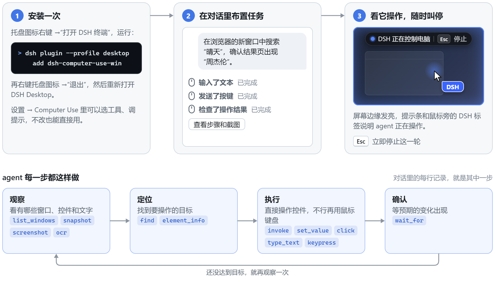
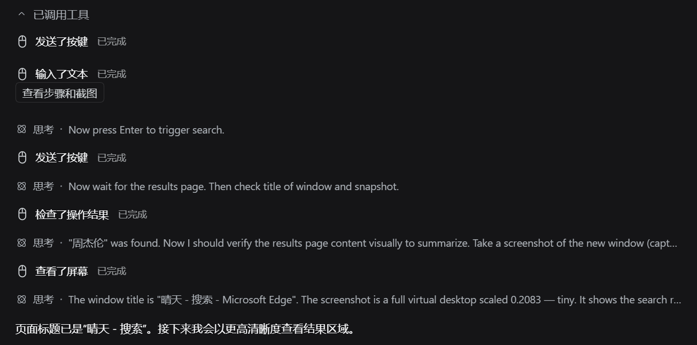
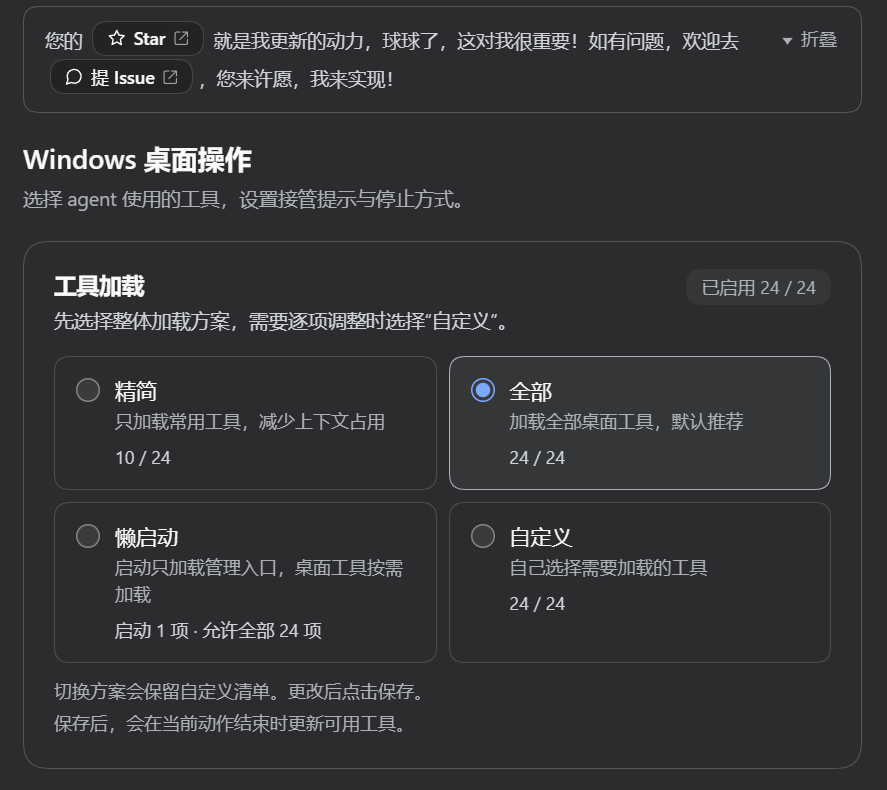
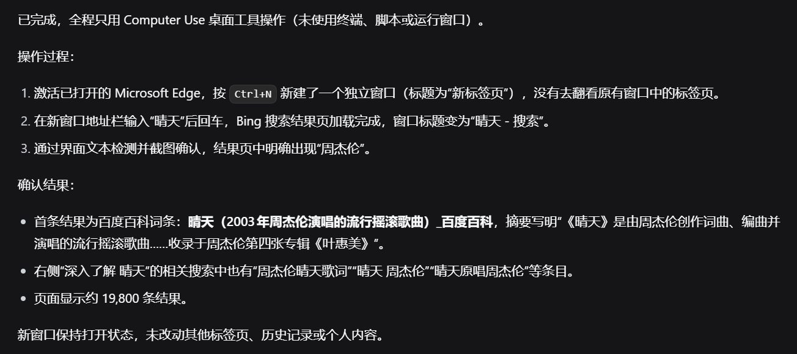
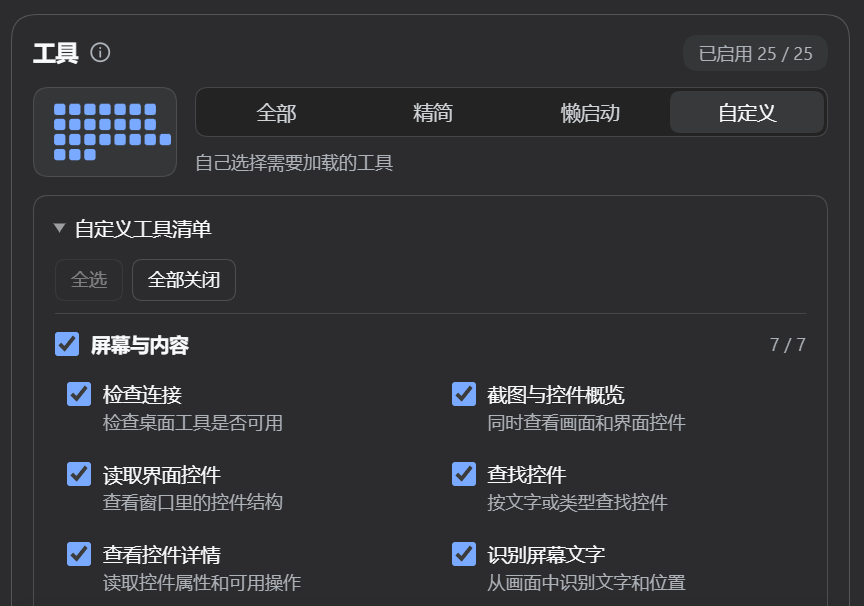
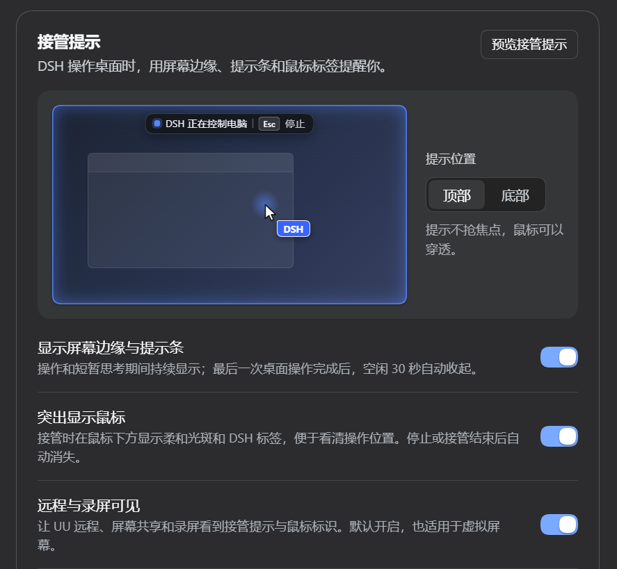
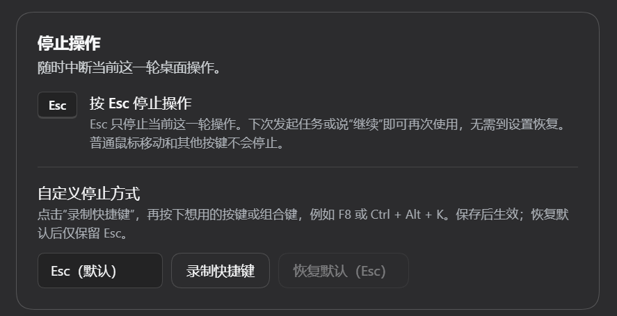
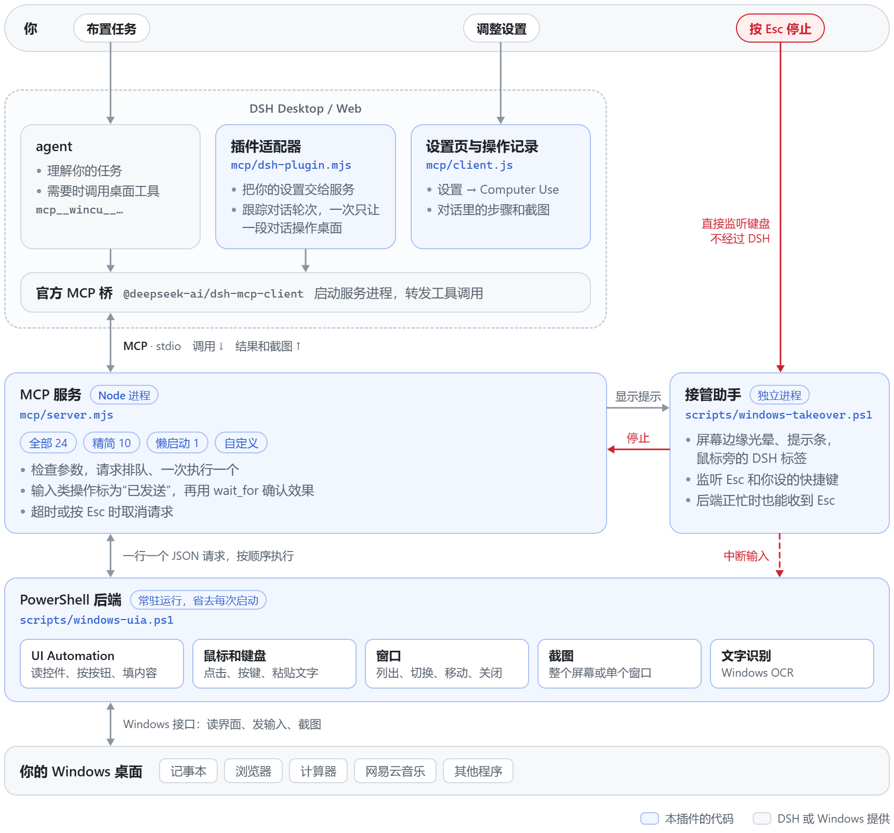
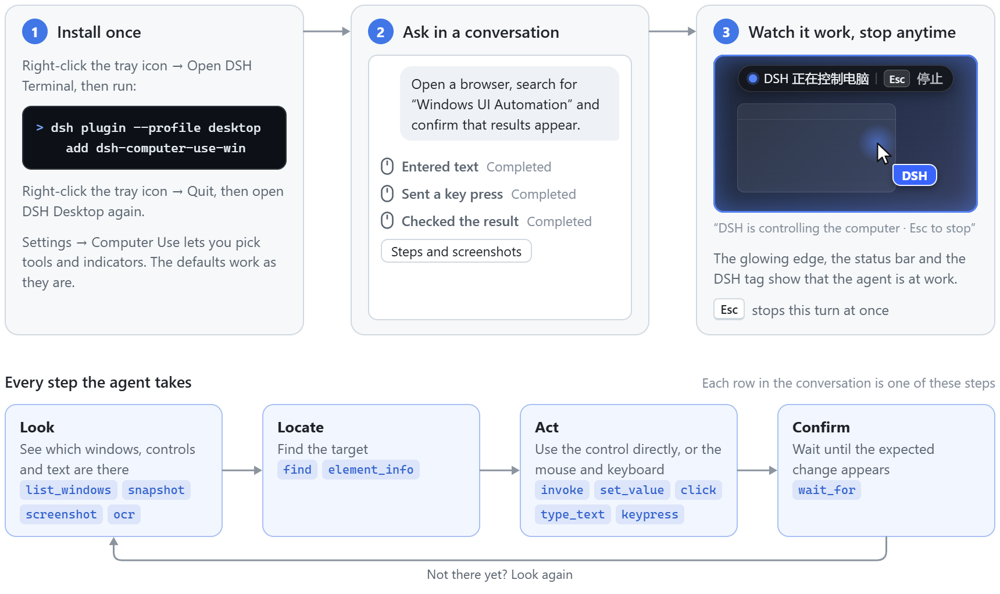

# dsh-computer-use-win

**让 DSH 看懂并操作你的 Windows 桌面。**

[](https://www.npmjs.com/package/dsh-computer-use-win) [](https://github.com/Yu-tao-Li/dsh-computer-use-win/actions/workflows/ci.yml)  [](LICENSE)

您的 [**Star ⭐ ↗**](https://github.com/Yu-tao-Li/dsh-computer-use-win) 就是我更新的动力，球球了，这对我很重要！如有问题，欢迎去 [**提 Issue ↗**](https://github.com/Yu-tao-Li/dsh-computer-use-win/issues/new)，**您来许愿，我来实现！**

**语言 / Language:** [简体中文](#简体中文) · [English](#english)

[Releases](https://github.com/Yu-tao-Li/dsh-computer-use-win/releases) · [npm](https://www.npmjs.com/package/dsh-computer-use-win) · [Issues](https://github.com/Yu-tao-Li/dsh-computer-use-win/issues)

---

## 简体中文

这个插件让 [DeepSeek Harness](https://github.com/deepseek-ai/deepseek-harness)（DSH）里的 agent 看到并操作你电脑上真实的 Windows 程序：找到按钮和输入框，读出屏幕上的文字，点击、打字，切换和管理窗口。

**23 个桌面工具 + 1 个管理入口 · 操作时有明显提示 · 按 Esc 随时停止 · 中英文设置界面**

<picture>
  <source media="(prefers-color-scheme: dark)" srcset="assets/diagrams/how-it-works-zh-dark.png">
  
</picture>

**目录**：[1 快速开始](#1-快速开始) · [2 界面预览](#2-界面预览) · [3 能做什么](#3-能做什么) · [4 工作原理](#4-工作原理) · [5 设置](#5-按你的习惯设置) · [6 使用示例](#6-使用示例) · [7 工具与进阶](#7-工具与进阶) · [8 常见问题](#8-常见问题) · [9 数据与隐私](#9-数据与隐私) · [10 文档与开发](#10-文档与开发) · [English](#english)

### 1. 快速开始

#### 1.1 安装

你需要一台 Windows 电脑，并且已经装好 DSH Desktop。插件用的是 Windows 自带的 PowerShell 5.1，不用另外安装。

1. 右键点击任务栏托盘里的 DSH 图标，选“打开 DSH 终端”，然后运行：

   ```powershell
   dsh plugin --profile desktop add dsh-computer-use-win
   ```

2. 再右键托盘图标，选“退出”，然后重新打开 DSH Desktop。只关掉窗口不够：窗口关了，DSH 还在托盘里运行，不会加载新装的插件。
3. 打开 **设置 → 电脑操控**（鼠标图标）看看各项选项。不改也能直接用，默认加载全部工具。然后给 agent 布置一个桌面任务，比如[第 6 节](#6-使用示例)里的例子。

#### 1.2 升级

运行同一条安装命令，然后像上面第 2 步那样完全退出、再重新打开 DSH Desktop。

命令里的 `desktop` 是 DSH Desktop 使用的配置（profile）。如果装到了别的 profile，正在用的 DSH 不会有任何变化。

#### 1.3 其他安装方式

<details>
<summary>DSH Web、GitHub 源、单独的 MCP 客户端</summary>

DSH Web：

```powershell
dsh plugin --profile web add dsh-computer-use-win
```

装好后重启 `dsh web`。用别的 profile 时，把 `web` 换成它的名字。也可以在插件市场搜索 **dsh-computer-use-win**，或者从 GitHub 安装：

```powershell
dsh plugin --profile desktop add github:Yu-tao-Li/dsh-computer-use-win
```

不在 DSH 里，也可以让任何 MCP 客户端启动它：

```json
{
  "mcpServers": {
    "wincu": {
      "command": "npx",
      "args": ["-y", "dsh-computer-use-win"]
    }
  }
}
```

DSH Web 和单独的 MCP 客户端会用你电脑上的 Node.js 运行插件，需要 22 或更高版本。DSH Desktop 自带运行环境，不用另装 Node.js。

单独运行时默认加载全部工具。设置环境变量 `WCU_TOOL_MODE=lite` 只加载常用工具，`WCU_TOOL_MODE=lazy` 开始时只加载管理入口。也可以在 `WCU_ENABLED_TOOLS` 里写一个 JSON 数组，指定允许哪些工具。设置页、对话里的操作记录和整轮提示只有在 DSH 里才有。详见[工具加载说明](docs/tool-context.md)。

</details>

### 2. 界面预览

下面是 DSH Desktop 2.0.18 和插件 0.5.1 的真实截图（中文界面）。演示任务是：新开一个浏览器窗口，搜索“晴天”，确认结果里有“周杰伦”。截图只保留了对话或设置面板，点击图片可以看原图。

#### 2.1 对话里能看到每一步

每次桌面操作都是一行带鼠标图标的记录，比如“输入了文本”“发送了按键”“检查了操作结果”。点“查看步骤和截图”，可以看到每一步的详情和截图。



#### 2.2 设置页

设置在左侧的“电脑操控”（鼠标图标）里。先选一种工具加载方案：精简、全部、懒启动或自定义，默认是“全部”（24 个工具）。顶部的 Star 和 Issue 说明可以点“折叠”收成一个链接，下图就是折叠后的样子，点“展开”就能恢复。



#### 2.3 更多截图

<details>
<summary>任务总结、自定义工具、接管提示、停止设置</summary>

**任务总结。** 一轮操作结束后，agent 会说明自己做了什么、在结果页里确认了什么。图中的文字由这次任务用的模型生成。



**自定义工具。** 选“自定义”后会展开工具清单，可以一个个勾选，也可以整组勾选。图中是没有保存的演示，截完图就放弃了。



**接管提示。** agent 操作桌面时，屏幕边缘会亮起蓝色光晕，顶部或底部出现“DSH 正在控制电脑”提示条，鼠标旁跟着一个 DSH 标签。这几样可以分别开关，设置页里有预览。



**停止设置。** 默认按 Esc 停止。你也可以再录一个自己的快捷键，比如 F8。



</details>

### 3. 能做什么

| 你想让 agent 做的事 | 插件怎么做到 |
|---|---|
| 找到窗口、按钮和输入框 | 列出打开的窗口，再通过 UI Automation（UIA，Windows 给程序读取界面控件的接口）找到控件和它们的名字 |
| 读出界面上的文字，包括图片和自绘界面里的字 | 截图，用 Windows 自带的文字识别（OCR）找出文字和位置。界面控件很少、又没找到目标时，查找会自动改用 OCR |
| 点击、输入、填写表单 | 优先直接操作控件，比如“按下按钮”“填入内容”，不行时再模拟鼠标和键盘。粘贴文字时不会挪动你的鼠标 |
| 等页面变化，确认操作真的生效 | 等某个窗口、控件或文字出现，再读取或截图确认 |
| 让你看清 agent 在做什么 | 屏幕提示、鼠标旁的 DSH 标签、对话里的步骤记录和结束总结 |

在 DSH 对话里，每次桌面操作都写成一句好懂的话，比如“点击了目标位置”，后面标出状态：“已完成”“操作已发送，效果待确认”“未完成”或“已停止”。重新打开对话时，这些记录还在。

### 4. 工作原理

#### 4.1 一次桌面任务怎么进行

agent 每一步都按“观察 → 定位 → 执行 → 确认”来做，开头那张图的下半部分画的就是这个循环：

1. **观察**：列出打开的窗口，读取界面控件，或者截图并识别文字。
2. **定位**：找到要操作的按钮、输入框或文字的位置。
3. **执行**：能直接操作控件就直接操作，比如按下按钮、填入内容，不行再用鼠标和键盘。
4. **确认**：等预期的变化出现，再读一次界面。没达到目标，就回到第 1 步。

插件会区分两种结果。输入类操作只返回“已发送”（`verification: "sent"`），因为程序收到了输入，不等于任务完成了。只有 `wait_for` 看到预期的窗口、控件或文字出现时，才返回“已确认”（`verification: "observed"`）。所以布置任务时，最好写明要确认什么。

#### 4.2 整体架构

<picture>
  <source media="(prefers-color-scheme: dark)" srcset="assets/diagrams/architecture-zh-dark.png">
  
</picture>

图里蓝色的部分是本插件的代码，灰色的部分由 DSH 或 Windows 提供。各部分的分工如下：

- **插件适配器**（`mcp/dsh-plugin.mjs`）运行在 DSH 里。它把你的设置交给 MCP 服务，并跟踪对话的轮次，保证同一时间只有一段对话在操作桌面。
- **设置页与操作记录**（`mcp/client.js`）就是“设置 → 电脑操控”这一页。它也负责把对话里的工具调用显示成好懂的步骤。
- **MCP 服务**（`mcp/server.mjs`）由 DSH 的官方 MCP 桥启动。它按你选的方案提供工具，检查参数后把请求交给后端。
- **PowerShell 后端**（`scripts/windows-uia.ps1`）负责读取界面、发送输入和截图。它一直运行，所以后续调用不用每次重新启动 PowerShell。请求排队，一次只执行一个，两个操作不会同时抢鼠标和键盘。
- **接管助手**（`scripts/windows-takeover.ps1`）是单独的进程，负责屏幕提示，并直接监听 Esc。因为它不经过 DSH 和后端，后端正忙时也能收到 Esc：还没开始的操作会被取消，正在进行的输入会尽快停下。

更多细节见[架构说明](docs/wiki/architecture.md)。

### 5. 按你的习惯设置

在 **设置 → 电脑操控** 里调整，点“保存更改”后生效。界面跟随 DSH 的明暗主题。如果读不到设置，页面会直接说明，而不是显示一份看起来正常的默认值。

#### 5.1 设置项

| 设置 | 可以怎么选 |
|---|---|
| 工具加载 | **全部**（24 个，默认）；**精简**（10 个常用工具）；**懒启动**（开始只加载 1 个管理工具，需要时再加载，全部工具都允许）；**自定义**（逐个或整组勾选） |
| 屏幕提示 | 开关屏幕边缘光晕和提示条；可以改提示文字，放在顶部或底部，并设置结束后多久收起（0.2–3 秒） |
| 鼠标提示 | 单独开关鼠标旁的光斑和 DSH 标签。不会改你的系统鼠标样式，调大了的指针也会自动避开 |
| 远程与录屏可见 | 默认打开，让 UU 远程、屏幕共享和录屏也能看到提示。换显示器、调整布局或缩放后会自动跟上 |
| 停止快捷键 | 点“录制快捷键”，按下想用的键（比如 F8 或 Ctrl + Alt + K），再保存。“恢复默认（Esc）”会清掉额外的快捷键 |
| 预览 | 保存后点“预览接管提示”，看看提示在你屏幕上的样子 |

#### 5.2 随时按 Esc 停止

按下 Esc 或你设的快捷键，这一轮的桌面操作和排队中的操作会立即停止，这一轮也不会自动重试。想继续时，直接发新任务或说“继续”就行，不用去设置里恢复。普通的鼠标移动和其他按键不会触发停止。即使关掉了屏幕提示，Esc 照样有效。

#### 5.3 提示什么时候出现、什么时候收起

第一次桌面操作开始时出现，之后截图、读取和短暂思考期间一直显示。这一轮结束、取消或出错后，按你设的时间收起。如果最后一次桌面操作后 30 秒都没有新操作，提示也会收起，下次操作时再出现。单独运行的 MCP 服务没有“轮”的概念，所以每次调用单独显示。

#### 5.4 使用须知

- 能直接操作控件时，插件会优先这样做，因为这样不用移动鼠标。但按坐标点击和键盘输入还是会用到你的鼠标和键盘，所以 agent 操作时最好别同时动它们。
- 同一时间只有一段对话能操作桌面，其他对话会收到“忙碌”的结果。
- 已经发给程序的操作无法撤回。如果程序卡住了，要等它响应后才能停下来。
- 切换方案时，你的自定义清单会保留。保存的改动在当前这一步操作结束后生效，重启后也还在。agent 不能打开你关掉的工具。

完整说明见[设置与停止](docs/computer-use-settings.md)。

### 6. 使用示例

#### 6.1 可以这样布置任务

> 在记事本中输入“会议纪要”，再读取文本确认写入成功。

> 在已打开的计算器中计算 25 × 4，并读取结果。

> 打开浏览器，搜索“Windows UI Automation”，确认出现搜索结果，并总结你做了什么。

> 打开网易云音乐，搜索“晴天”，确认结果页出现“周杰伦”。如果无障碍树看不到搜索框，用 OCR 定位可见文字。

任务里写清楚要确认什么，agent 就会去检查结果，而不是把输入发出去就结束（见 [4.1](#41-一次桌面任务怎么进行)）。结果也取决于目标程序、所用的模型和当前页面。

### 7. 工具与进阶

#### 7.1 工具清单

一共 **23 个桌面工具和 1 个管理入口**。下表用的是短名；完整名字是 `windows_computer_use_<短名>`，在 DSH 里通常还会加上 `mcp__wincu__` 前缀。

| 用途 | 工具 |
|---|---|
| 检查连接、找窗口 | `health` · `list_windows` |
| 读取界面控件（UIA） | `snapshot` · `accessibility_tree` · `find` · `element_info` |
| 截图和文字识别 | `screenshot` · `ocr` |
| 鼠标 | `click` · `double_click` · `move` · `drag` · `scroll` |
| 输入文字、操作控件 | `type_text` · `keypress` · `focus` · `invoke` · `set_value` |
| 管理窗口 | `activate_window` · `move_window` · `close_window` |
| 等待和确认 | `wait_for` · `wait` |
| 管理工具 | `tools` |

#### 7.2 精简方案与管理入口

精简方案包含 `list_windows`、`find`、`click`、`scroll`、`type_text`、`keypress`、`ocr`、`screenshot`、`wait_for` 和 `tools`。

有了管理入口 `tools`，agent 可以查看某个工具的说明，也可以临时卸载或重新加载你允许的工具；`reset` 会恢复你保存的启动方案。卸载工具不会删掉对话里已有的说明和结果。

#### 7.3 使用建议

能用 UIA 找到控件时，用 `invoke` / `set_value` 直接操作。UIA 找不到，或者只找到很少的控件时，用 OCR 读屏幕上的文字；图标和布局交给能看图的模型读截图。OCR 只返回文字和屏幕坐标，不会编造控件 ID。窗口移动或控件变化后，要重新观察。

Electron 程序、Chrome 和 Edge 都用 Chromium 内核。这类程序要等有程序来读网页，才会生成网页里的控件。所以插件第一次读这类窗口时，会先替它打开网页的控件树，一般不到半秒就能读到网页里的按钮和输入框。结果里的 `webContent` 说明网页是否就绪；如果显示 `starting`，稍等再读一次。

[完整参数与返回值](docs/wiki/mcp-tools.md) · [按需加载与客户端兼容性](docs/tool-context.md) · [不同应用的技术差异](docs/wiki/app-technology-matrix.md)

### 8. 常见问题

#### 8.1 装好了，却看不到工具或设置页，或者还是旧版本？

最常见的原因是 DSH Desktop 没有完全重启：只关窗口时，DSH 还在托盘里运行旧版插件。请右键托盘图标选“退出”，再重新打开。

也要确认插件装到了 DSH 正在用的 profile。版本号可以在 MCP 返回的 `initialize.serverInfo.version` 里看；选“全部”方案时，也可以让 agent 调用 `health` 检查连接。同一个 profile 里只应有一个 `serverName: wincu` 服务。如果旧版本留下过重复的手动配置，先备份，再按[升级说明](docs/computer-use-settings.md)处理。

提交问题时，请附上 DSH Desktop、dsh 内核和插件的版本号，以及去掉隐私后的报错文字。

#### 8.2 为什么点击或输入没有反应？

先看目标窗口是不是在最前面、有没有被挡住、程序是不是卡住了。Chromium、Electron 和部分 WinUI 程序会忽略后台输入，所以优先用 UIA 操作，或者先把目标窗口切到前台再输入，然后看看实际效果。以管理员身份运行的窗口和 UAC 确认界面受 Windows 权限保护，插件无法操作。插件还需要一个正常可用的桌面会话。

#### 8.3 支持 PowerShell 7、其他系统，或者自带看图模型吗？

只支持 Windows。默认用 PowerShell 5.1，它的文字识别（WinRT OCR）经过了真实测试。自动测试同时覆盖 PowerShell 5.1 和 7：在 7 上，界面读取和截图有真实测试，但文字识别只测了协议，所以还不能保证 7 上的文字识别可用。

插件只提供桌面工具，不带模型、API key，也不带 OmniParser、UI-TARS 这类看图解析工具。能看图的模型或单独的解析服务可以读截图，再把位置交给插件去操作。

### 9. 数据与隐私

界面读取、文字识别、截图和输入都在你的电脑上完成，结果交给 DSH 或其他调用方。这些内容会不会再发给远程模型，取决于你的 DSH 和模型设置。截图和读出的文字可能包含窗口里的敏感信息，所以分享日志或提 Issue 之前，请先遮住账号、路径、密码和私人对话。

### 10. 文档与开发

#### 10.1 文档

[设置与停止](docs/computer-use-settings.md) · [工具加载](docs/tool-context.md) · [工具参数](docs/wiki/mcp-tools.md) · [架构](docs/wiki/architecture.md) · [测试记录](docs/dev-notes.md) · [更新日志](CHANGELOG.md)

#### 10.2 开发与测试

各部分怎么配合，见 [4.2 整体架构](#42-整体架构)。

```powershell
npm ci
npm test
```

单独运行的 MCP 服务不依赖任何第三方包；接入 DSH 时，用的是 DSH 自带的 Schemastery 和官方 MCP 桥。开发依赖只用于测试。`npm test` 会运行 **27 套互相隔离的回归测试**，覆盖设置兼容、接管与停止、界面读取、截图、文字识别协议和输入边界。它不会发出真实的键盘鼠标输入，也不会改动你装好的 DSH 配置；需要真实界面的测试只操作专用的测试窗口，日志写在命令输出的临时目录里。

`node test/notepad-e2e.mjs` 是另一项会真实打字的测试，它会打开记事本，请在专门的测试桌面上运行。

README 里的两张图由 `assets/diagrams/` 里的网页生成。改了图里的文字后，运行 `node assets/diagrams/render.mjs`，它会用本机的 Chrome 或 Edge 重新导出中英文、浅色和深色共 8 张图。

MIT 许可。本项目基于 [cgissing/windows-computer-use](https://github.com/cgissing/windows-computer-use) 衍生，来源与版权见 [THIRD_PARTY.md](THIRD_PARTY.md)。

[插件市场](https://awesome-dsh-plugin.com) · [发布记录](https://github.com/Yu-tao-Li/dsh-computer-use-win/releases) · [反馈问题](https://github.com/Yu-tao-Li/dsh-computer-use-win/issues) · [返回中文顶部 ↑](#简体中文)

---

## English

This plugin lets a [DeepSeek Harness](https://github.com/deepseek-ai/deepseek-harness) (DSH) agent see and use the real Windows apps on your computer. It can find buttons and text fields, read text on the screen, click, type, and switch or manage windows.

**23 desktop tools + 1 management entry · Clear on-screen indicators · Press Esc to stop at any time · Chinese and English settings**

<picture>
  <source media="(prefers-color-scheme: dark)" srcset="assets/diagrams/how-it-works-en-dark.png">
  
</picture>

**Contents:** [1 Quick start](#1-quick-start) · [2 Interface tour](#2-interface-tour) · [3 What it can do](#3-what-it-can-do) · [4 How it works](#4-how-it-works) · [5 Settings](#5-make-it-yours) · [6 Try a task](#6-try-a-task) · [7 Tools](#7-tools-and-options) · [8 FAQ](#8-faq) · [9 Privacy](#9-data-and-privacy) · [10 Development](#10-documentation-and-development) · [简体中文](#简体中文)

### 1. Quick start

#### 1.1 Install

You need a Windows computer with DSH Desktop installed. The plugin uses Windows PowerShell 5.1, which comes with Windows, so there is nothing else to install.

1. Right-click the DSH icon in the taskbar tray, choose **Open DSH Terminal**, and run:

   ```powershell
   dsh plugin --profile desktop add dsh-computer-use-win
   ```

2. Right-click the tray icon again, choose **Quit**, then open DSH Desktop again. Closing the window is not enough: DSH keeps running in the tray and does not load the new plugin.
3. Open **Settings → Computer Use** (the mouse icon; 电脑操控 in the Chinese interface) to look around. You don't have to change anything: all tools are loaded by default. Then give the agent a desktop task, such as one from [section 6](#6-try-a-task).

#### 1.2 Upgrade

Run the same install command, then fully quit and reopen DSH Desktop as in step 2 above.

The `desktop` in the command is the profile that DSH Desktop uses. If you install into another profile, the DSH you are using does not change.

#### 1.3 Other ways to install

<details>
<summary>DSH Web, GitHub, standalone MCP clients</summary>

For DSH Web:

```powershell
dsh plugin --profile web add dsh-computer-use-win
```

Restart `dsh web` after installing. If you use another profile, replace `web` with its name. You can also search the plugin marketplace for **dsh-computer-use-win**, or install from GitHub:

```powershell
dsh plugin --profile desktop add github:Yu-tao-Li/dsh-computer-use-win
```

Outside DSH, any MCP client can launch it:

```json
{
  "mcpServers": {
    "wincu": {
      "command": "npx",
      "args": ["-y", "dsh-computer-use-win"]
    }
  }
}
```

DSH Web and standalone MCP clients run the plugin with the Node.js on your computer, which must be version 22 or later. DSH Desktop brings its own runtime, so it needs no separate Node.js.

Run on its own, the server loads all tools by default. Set `WCU_TOOL_MODE=lite` to load only the common tools, or `WCU_TOOL_MODE=lazy` to start with just the management entry. You can also list the allowed tools as a JSON array in `WCU_ENABLED_TOOLS`. The settings page, the action records in conversations and the turn-wide indicators exist only inside DSH. See [tool loading](docs/tool-context.md) for details.

</details>

### 2. Interface tour

These are real screenshots from DSH Desktop 2.0.18 and plugin 0.5.1, with the Chinese interface. In the demo task, the agent opened a new browser window, searched for “晴天” and confirmed that “周杰伦” appeared in the results. Each image shows only the conversation or the settings panel. Click an image to see it at full size.

#### 2.1 Every step shows up in the conversation

Each desktop action is a row with a mouse icon, such as “Entered text”, “Sent a key press” or “Checked the result” (the screenshot shows the Chinese labels). Click **Steps and screenshots** to see the details and screenshots of each step.


#### 2.2 Settings page

The settings are under Computer Use, the tab with the mouse icon on the left (电脑操控 in the Chinese interface). First pick how tools are loaded: Lite, All, Lazy or Custom. All (24 tools) is the default. Collapse folds the Star and Issue note at the top into a single link, as in the screenshot, and Expand brings it back.


#### 2.3 More screenshots

<details>
<summary>Task summary, custom tools, control indicators, stop settings</summary>

**Task summary.** When a turn ends, the agent explains what it did and what it confirmed on the results page. The text in this image was written by the model used for the task.


**Custom tools.** Choosing Custom opens the tool list. Tick tools one by one, or a whole group at once. This is an unsaved demo that was discarded after the screenshot.


**Control indicators.** While the agent uses the desktop, a blue glow lines the screen edges, a “DSH 正在控制电脑” bar appears at the top or bottom, and a DSH tag follows the pointer. Each one has its own switch, and the settings page shows a preview.


**Stop settings.** Esc stops the agent by default. You can also record your own shortcut, such as F8.


</details>

### 3. What it can do

| What you want the agent to do | How the plugin does it |
|---|---|
| Find windows, buttons and text fields | It lists open windows, then uses UI Automation (UIA, the Windows interface that lets programs read on-screen controls) to find controls and their names |
| Read text on screen, including text in images and custom-drawn apps | It takes a screenshot and uses the built-in Windows text recognition (OCR) to find words and their positions. When an app exposes few controls and a search finds nothing, the search switches to OCR by itself |
| Click, type and fill in forms | It operates controls directly when it can, for example “press this button” or “fill in this field”, and falls back to mouse and keyboard input. Pasting text does not move your mouse |
| Wait for changes and check that an action worked | It waits for a window, control or piece of text to appear, then reads or captures the screen to confirm |
| Show you what the agent is doing | Screen indicators, the DSH tag next to the pointer, step records in the conversation and a summary at the end |

In a DSH conversation, each desktop action reads as a short sentence, such as “Clicked the target”, followed by its status: “Completed”, “Input sent; effect unconfirmed”, “Incomplete” or “Stopped”. The records are still there when you reopen the conversation.

### 4. How it works

#### 4.1 How a desktop task runs

The agent takes every step as **look → locate → act → confirm**. The lower half of the first figure shows this loop:

1. **Look**: list the open windows, read the controls, or take a screenshot and recognize the text.
2. **Locate**: find the button, text field or piece of text to work on.
3. **Act**: operate the control directly when possible, such as pressing a button or filling in a field, and otherwise use the mouse and keyboard.
4. **Confirm**: wait for the expected change and read the screen again. If the goal is not met yet, go back to step 1.

The plugin keeps two kinds of result apart. Input actions only report “sent” (`verification: "sent"`), because an app receiving input does not mean the task is done. Only `wait_for` reports “observed” (`verification: "observed"`), when the expected window, control or text actually appears. So when you give a task, say what should be checked.

#### 4.2 Architecture

<picture>
  <source media="(prefers-color-scheme: dark)" srcset="assets/diagrams/architecture-en-dark.png">
  
</picture>

The blue parts are this plugin's code, and the grey parts come from DSH or Windows. Here is what each part does:

- The **plugin adapter** (`mcp/dsh-plugin.mjs`) runs inside DSH. It passes your settings to the MCP server and tracks conversation turns, so only one conversation uses the desktop at a time.
- The **settings page and step records** (`mcp/client.js`) are the Settings → Computer Use page. The same file turns the tool calls in a conversation into readable steps.
- The **MCP server** (`mcp/server.mjs`) is started by DSH's official MCP bridge. It offers the tools of your preset, checks the arguments and passes each request to the backend.
- The **PowerShell backend** (`scripts/windows-uia.ps1`) reads the screen, sends input and takes screenshots. It stays running, so later calls skip PowerShell startup. Requests wait in a queue and run one at a time, so two actions never fight over the mouse and keyboard.
- The **takeover helper** (`scripts/windows-takeover.ps1`) is a separate process that draws the indicators and listens for Esc itself. Because it goes through neither DSH nor the backend, it hears Esc even while the backend is busy: actions that have not started are cancelled, and input in progress stops as soon as it can.

See the [architecture notes](docs/wiki/architecture.md) for more detail.

### 5. Make it yours

Change these in **Settings → Computer Use**, then click Save changes. The page follows DSH's light or dark theme. If the settings cannot be read, the page says so instead of showing defaults that look valid.

#### 5.1 Settings

| Setting | Your choices |
|---|---|
| Tool loading | **All** (24 tools, the default); **Lite** (10 common tools); **Lazy** (starts with 1 management tool and loads the rest when needed, with all tools allowed); **Custom** (pick tools one by one or by group) |
| Screen indicator | Turn the edge glow and the status bar on or off. Change the text, put the bar at the top or bottom, and choose how long it stays after a turn ends (0.2–3 seconds) |
| Pointer indicator | Turn the glow and DSH tag at the pointer on or off on their own. Your Windows pointer style is not changed, and the tag stays clear of enlarged pointers |
| Visible in remote sessions and recordings | On by default, so UU Remote, screen sharing and recordings can show the indicators too. It keeps up when you change monitors, layout or scaling |
| Stop shortcut | Click Record shortcut, press the key you want (such as F8 or Ctrl + Alt + K), then save. Restore default (Esc) removes the extra shortcut |
| Preview | After saving, click Preview indicator to see how it looks on your screen |

#### 5.2 Press Esc to stop at any time

Esc, or your own shortcut, stops this turn's desktop actions right away, including queued ones, and the agent will not retry them in the same turn. To carry on, send a new task or say “continue”. There is no need to visit settings. Normal mouse movement and other keys do not stop anything. Esc still works even if you turn the indicators off.

#### 5.3 When the indicators appear and disappear

They appear with the first desktop action and stay on through screenshots, reading and short pauses for thinking. When the turn ends, is cancelled or fails, they fade out after the delay you set. If 30 seconds pass after the last desktop action with nothing new, they also hide, and they come back with the next action. A standalone MCP server has no notion of turns, so it shows them for each call.

#### 5.4 Good to know

- The plugin operates controls directly when it can, because that does not move the mouse. Clicks at screen positions and keyboard input still use your mouse and keyboard, so avoid using them while the agent works.
- Only one conversation can use the desktop at a time. Others get a “busy” result.
- An action already delivered to an app cannot be undone. If the app is stuck, stopping waits until it responds.
- Switching presets keeps your custom list. Saved changes take effect after the current step finishes and survive a restart. The agent cannot turn on tools you have turned off.

See [settings and stopping](docs/computer-use-settings.md) for the full details.

### 6. Try a task

#### 6.1 Example tasks

> Type “Meeting notes” into Notepad, then read the text back to confirm it was entered.

> Calculate 25 × 4 in the open Calculator window and read the result.

> Open a browser, search for “Windows UI Automation”, confirm that results appeared, and summarize what you did.

> Open NetEase Cloud Music, search for “晴天”, and confirm that “周杰伦” appears in the results. If UIA cannot find the search box, use OCR to locate visible text.

When the task says what to confirm, the agent checks the result instead of stopping once the input is sent (see [4.1](#41-how-a-desktop-task-runs)). Results also depend on the app, the model and the page you are on.

### 7. Tools and options

#### 7.1 Tool list

There are **23 desktop tools and 1 management entry**. The table uses short names. The full name is `windows_computer_use_<name>`, and DSH usually adds a `mcp__wincu__` prefix.

| Purpose | Tools |
|---|---|
| Check the connection, find windows | `health` · `list_windows` |
| Read on-screen controls (UIA) | `snapshot` · `accessibility_tree` · `find` · `element_info` |
| Screenshots and text recognition | `screenshot` · `ocr` |
| Mouse | `click` · `double_click` · `move` · `drag` · `scroll` |
| Type and operate controls | `type_text` · `keypress` · `focus` · `invoke` · `set_value` |
| Manage windows | `activate_window` · `move_window` · `close_window` |
| Wait and confirm | `wait_for` · `wait` |
| Manage tools | `tools` |

#### 7.2 Lite preset and the management entry

Lite includes `list_windows`, `find`, `click`, `scroll`, `type_text`, `keypress`, `ocr`, `screenshot`, `wait_for` and `tools`.

Through the `tools` entry, the agent can read a tool's description, and unload or reload tools you have allowed. `reset` returns to your saved startup set. Unloading a tool does not remove its description or results from the conversation.

#### 7.3 Tips

When UIA can find a control, operate it directly with `invoke` or `set_value`. When UIA finds nothing, or very little, read the screen text with OCR, and let a model that can see images read the screenshot for icons and layout. OCR returns only text and screen positions; it never makes up control IDs. Look again after a window moves or a control changes.

Electron apps, Chrome and Edge are all built on Chromium. Such an app builds the controls of a page only once another program reads the page. So the first time the plugin reads one of these windows, it turns the page's control tree on, and the page's buttons and input boxes usually become readable within half a second. `webContent` in the result tells you whether the page is ready. If it says `starting`, wait a moment and read again.

[Parameters and results](docs/wiki/mcp-tools.md) · [On-demand loading and client compatibility](docs/tool-context.md) · [How apps differ](docs/wiki/app-technology-matrix.md)

### 8. FAQ

#### 8.1 It's installed, but I see no tools or settings, or an old version is still running

Most often, DSH Desktop was not fully restarted. Closing the window leaves DSH running in the tray with the old plugin, so right-click the tray icon, choose Quit, and open DSH Desktop again.

Also check that the plugin went into the profile DSH is actually using. The version appears in the MCP `initialize.serverInfo.version`; with All selected, the agent can also call `health` to check the connection. Each profile should have only one `serverName: wincu` service. If an older version left a duplicate manual entry, back it up first, then follow the [upgrade notes](docs/computer-use-settings.md).

When you report an issue, include the DSH Desktop, dsh core and plugin versions, plus the error text with private details removed.

#### 8.2 Why did a click or typed text have no effect?

Check that the target window is in front, not covered, and still responding. Chromium, Electron and some WinUI apps ignore input sent to background windows, so prefer UIA, or bring the window to the front before typing, and then look at the result. Windows protects apps running as administrator and the UAC prompt, so the plugin cannot operate them. The plugin also needs a normal, unlocked desktop session.

#### 8.3 What about PowerShell 7, other systems or a built-in vision model?

It works on Windows only. PowerShell 5.1 is the default, and its text recognition (WinRT OCR) has been tested on real screens. The automated tests cover both PowerShell 5.1 and 7. Under 7, reading controls and taking screenshots are tested for real, but text recognition is only tested at the protocol level, so OCR under PowerShell 7 is not guaranteed.

The plugin provides desktop tools only. It does not include a model, an API key, or image parsers such as OmniParser or UI-TARS. A model that can see images, or a separate parsing service, can read the screenshots and pass positions back to the tools.

### 9. Data and privacy

Reading controls, text recognition, screenshots and input all run on your computer. The results go to DSH or another caller, and whether they are then sent to a remote model depends on your DSH and model settings. Screenshots and recognized text can include sensitive content from your windows, so hide accounts, paths, passwords and private chats before you share logs or open an issue.

### 10. Documentation and development

#### 10.1 Documentation

[Settings and stopping](docs/computer-use-settings.md) · [Tool loading](docs/tool-context.md) · [Tool reference](docs/wiki/mcp-tools.md) · [Architecture](docs/wiki/architecture.md) · [Test notes](docs/dev-notes.md) · [Changelog](CHANGELOG.md)

#### 10.2 Development and testing

See [4.2 Architecture](#42-architecture) for how the parts fit together.

```powershell
npm ci
npm test
```

The standalone MCP server needs no third-party packages at runtime. Inside DSH, it uses DSH's own Schemastery and the official MCP bridge. Development dependencies are only for testing. `npm test` runs **27 isolated regression suites** covering settings compatibility, takeover and stopping, reading controls, capture, OCR protocols and input edge cases. It sends no real keyboard or mouse input and does not touch your installed DSH profiles. Tests that need a real interface use only their own test windows, and logs go to the temporary folder the command prints.

`node test/notepad-e2e.mjs` is a separate test that really types. It opens Notepad, so run it on a dedicated test desktop.

The two figures in this README are generated from the pages in `assets/diagrams/`. After changing their text, run `node assets/diagrams/render.mjs`; it uses your local Chrome or Edge to export all 8 images again, in Chinese and English, light and dark.

MIT licensed. Derived from [cgissing/windows-computer-use](https://github.com/cgissing/windows-computer-use); see [THIRD_PARTY.md](THIRD_PARTY.md) for attribution and copyright.

[Plugin marketplace](https://awesome-dsh-plugin.com) · [Releases](https://github.com/Yu-tao-Li/dsh-computer-use-win/releases) · [Report an issue](https://github.com/Yu-tao-Li/dsh-computer-use-win/issues) · [Back to English ↑](#english)
